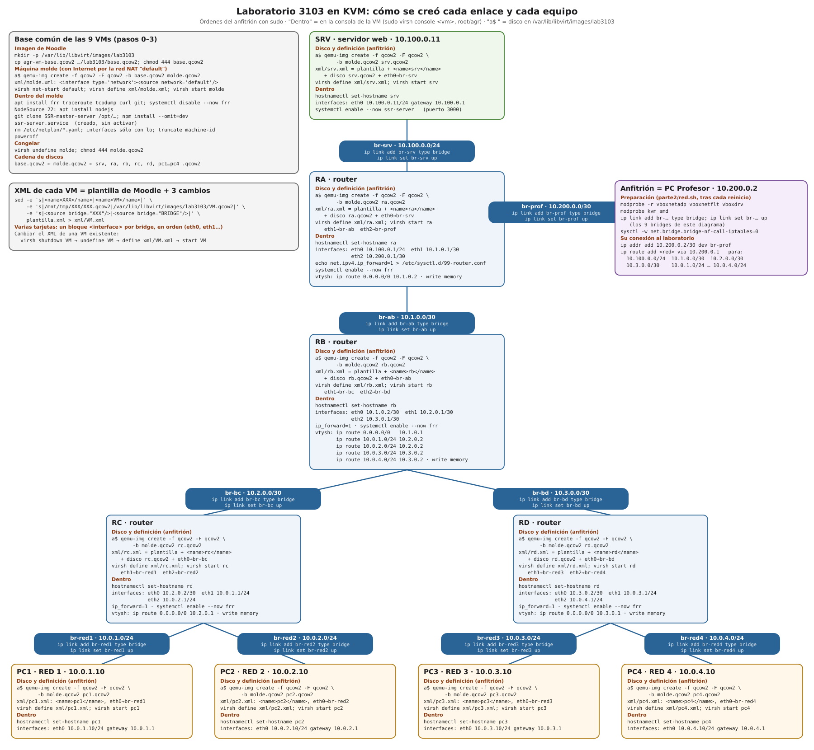

# Introducción

La práctica tiene dos partes:

1. **Virtualización de servicios web con Vagrant.** Un script Vagrant (Ruby)
   despliega una máquina virtual Linux con el servidor Node.js
   [SSR-master-server](https://github.com/gisai/SSR-master-server), accesible
   en el puerto 3000 desde la VM y en el 8080 desde el exterior. Se estudia el
   consumo de recursos y cuánto costaría virtualizar el laboratorio 3103.
2. **Virtualización de infraestructura de red con QEMU-KVM.** Un script en
   Python despliega la red del laboratorio 3103: 4 routers con la Software
   Routing Suite FRR, un servidor web y un PC por cada red inferior. Tiene
   rutas estáticas para lograr conectividad global y el anfitrión hace de
   PC del profesor.

El repositorio es autocontenido:

| Ruta | Contenido |
|---|---|
| `parte1-vagrant/Vagrantfile` | Entregable de la parte 1 |
| `parte2/despliegue.py` | Entregable de la parte 2 (script de despliegue) |
| `parte2/plantilla.xml`, `parte2/molde/`, `parte2/vm/` | Plantilla XML de Moodle, software común y configuración de cada VM que usa el script |
| `doc/entregables/` | Esta memoria y los documentos complementarios en PDF (guía paso a paso, requisitos punto a punto, red del laboratorio, diagramas, manual de uso) |
| `doc/development/` | Enunciado, plan de numeración, medidas en bruto, capturas de pantalla y salidas de las pruebas |

Ambas partes se probaron en el mismo anfitrión: **AMD Ryzen 7 7700X
(8 núcleos / 16 hilos), 30 GiB de RAM, Ubuntu**, con VirtualBox 7.2.20 y
Vagrant 2.4.9 en la parte 1 y QEMU-KVM + libvirt en la parte 2.

# Parte 1 — Servicio web virtualizado con Vagrant

## 1.1. Objetivo y entregable

El enunciado pide un script Vagrant que:

- despliegue una VM Linux (distribución libre);
- instale Node.js, descargue de GitHub el código del servidor y lo ejecute;
- redirija puertos para que el servidor sea accesible **desde el exterior en
  el 8080** y **desde la propia VM en el 3000**;
- asigne a la VM una dirección de red acorde al tipo de conexión elegido.

Además, se valora explorar configuraciones adicionales, como varias
interfaces en una misma VM. También se pide estudiar el consumo de memoria y
CPU, estimar el de una réplica virtualizada del laboratorio y compararlo con
servidores comerciales.

Requisitos propios añadidos: **teclado en español** y que, **al iniciar
sesión, se imprima la configuración del servidor**.

**Entregable:** `parte1-vagrant/Vagrantfile`.

## 1.2. Configuración que proporciona el script

| Elemento | Configuración |
|---|---|
| Proveedor / box | VirtualBox, `bento/ubuntu-22.04` como clon enlazado (`linked_clone`) |
| Recursos | 1 vCPU con tope del 80 % de una CPU del anfitrión y 1024 MB de RAM. Parametrizables con `VM_CPUS` y `VM_MEMORY` |
| Nombre | `agr-nodeserver` (nombre de la VM y hostname) |
| Red 1 – NAT | Salida a Internet y *port forwarding* `anfitrión:8080 → VM:3000` en todas las interfaces del anfitrión |
| Red 2 – privada | host-only `192.168.56.10/24` (red del servicio) |
| Red 3 – privada | host-only `192.168.57.10/24` (red de gestión) |
| Red 4 – pública (opcional) | Bridge sobre una interfaz física con IP por DHCP: `BRIDGE_IF=<if> vagrant up` |
| Sistema | Teclado español (consola y X11), locale `es_ES.UTF-8`, zona horaria `Europe/Madrid` |
| Software | Node.js 22 (NodeSource). El código se clona de GitHub en `/opt/ssr-master-server` |
| Servicio | Unidad systemd `ssr-server`: usuario sin privilegios `nodeapp` y reinicio automático |
| Seguridad | Cortafuegos `ufw`: sólo 22/tcp y 3000/tcp |
| Inicio de sesión | `/etc/profile.d/99-servidor-info.sh` imprime sistema, red, estado del servicio, URLs, puertos y cortafuegos |
| Convivencia con KVM | Un *trigger* `before :up` descarga `kvm_amd`/`kvm_intel` y carga `vboxdrv`. VirtualBox y KVM no pueden usar VT-x/AMD-V a la vez |

Esquema de red de la VM:

```
                    Internet
                       |
                  [NAT VirtualBox]  anfitrión:8080 ──► VM:3000
                       |
        ┌──────────── eth0 (enp0s3, 10.0.2.15) ────────────┐
        │                agr-nodeserver                     │
        │   eth1 192.168.56.10/24     eth2 192.168.57.10/24  │
        └─────────┬───────────────────────────┬──────────────┘
          vboxnet0 (servicio)         vboxnet1 (gestión)
                  │                           │
             anfitrión                    anfitrión
          192.168.56.1                 192.168.57.1
          (+ eth3 bridge opcional, IP por DHCP de la LAN)
```

## 1.3. Estructura del Vagrantfile

El aprovisionamiento son cuatro *provisioners* de tipo `shell`, todos
idempotentes: `vagrant provision` puede repetirse sin efectos indeseados.

| Provisioner | Qué hace |
|---|---|
| `sistema` | Teclado `es` (`/etc/default/keyboard`, `setupcon`, `localectl`), locale, zona horaria, paquetes base y `ufw` |
| `node` | Repositorio de NodeSource y Node.js 22, sólo si no estaba ya instalado |
| `servidor` | Crea el usuario `nodeapp`, hace `git clone` (o `git pull` si ya existe) y `npm install --omit=dev`. Después crea, habilita y arranca la unidad `ssr-server.service` y espera a que el puerto 3000 responda |
| `login-info` | Desactiva el MOTD de Ubuntu e instala el script que imprime la configuración al iniciar sesión |

Al terminar `vagrant up`, `post_up_message` muestra las tres URLs de acceso:
`http://localhost:8080` desde el anfitrión, `http://192.168.56.10:3000` por la
red privada y `http://localhost:3000` desde la VM.

**Incidencia del servidor.** `app.js` ya ejecuta `app.listen(3000)`, y
`bin/www`, que es lo que lanza `npm start`, vuelve a escuchar en el mismo
puerto. Por eso `npm start` termina con `EADDRINUSE`. El servicio lanza
directamente `node app.js`.

## 1.4. Uso

```bash
cd parte1-vagrant
vagrant up                     # crea y aprovisiona la VM
vagrant ssh                    # entra; se imprime la configuración del servidor
curl http://localhost:8080     # desde el anfitrión (port forwarding)
vagrant halt | vagrant destroy -f
```

## 1.5. Pruebas realizadas

| Prueba | Orden | Resultado |
|---|---|---|
| Servicio desde la VM (puerto 3000) | `vagrant ssh -c "curl -s localhost:3000"` | HTML del Data-Logger |
| Port forwarding (puerto 8080) | `curl http://localhost:8080` en el anfitrión | HTTP 200 |
| Red privada | `curl http://192.168.56.10:3000` | HTTP 200 |
| Escritura de datos | `curl "localhost:8080/record?id_nodo=n1&temperatura=24.5&..."` | `Saving: ...` y un CSV nuevo en `/logs` |
| Carga | 20 000 + 5000 peticiones a `/record` | 53 CSV generados, sin errores |
| Información al iniciar sesión | `vagrant ssh` | Se imprime la configuración del servidor |
| Teclado | Consola de VirtualBox (`VM_GUI=true`) | Distribución española |

## 1.6. Estudio de consumo del servicio virtualizado

Medidas tomadas sobre la VM `agr-nodeserver` desplegada con el `Vagrantfile`:
Ubuntu 22.04, 1 vCPU, 1 GB de RAM, Node.js 22 y SSR-master-server. Los datos
en bruto están en `doc/development/parte1/consumo_raw.txt`.

**Metodología:** medidas desde el anfitrión (`ps`, `VBoxManage metrics`,
`du`) y desde el invitado (`free`, `df`, `top`). Se midió en reposo y durante
una carga de 5000 peticiones HTTP secuenciales a `/record` a través del port
forwarding (`localhost:8080 → VM:3000`). Antes de esa carga ya se habían
enviado unas 20 000 peticiones. El crecimiento de la imagen se vigiló con el
comando que propone el enunciado:

```bash
watch "ls -al ~/VirtualBox\ VMs/agr-nodeserver/Snapshots/"
```

### Memoria

| Medida | Reposo | Con carga | Tras carga |
|---|---|---|---|
| RSS del proceso `VBoxHeadless` (anfitrión) | **1.04 GiB** | 1.05 GiB | 1.05 GiB |
| RAM usada por el invitado (sin caché) | 202 MiB | 206 MiB | 204 MiB |
| Caché de disco del invitado | 685 MiB | 680 MiB | 692 MiB |
| RSS del proceso `node app.js` | 85 MiB | 86 MiB | — |

- La aplicación es ligera: el sistema operativo y el servidor usan unos
  **200 MiB**, y Node.js unos 85 MiB.
- Sin embargo, **al anfitrión la VM le cuesta toda la RAM asignada (1 GB) más
  unos 70 MiB de sobrecarga de VirtualBox.** El invitado usa la memoria libre
  como caché de disco y VirtualBox no la devuelve. En virtualización completa
  se paga la RAM *reservada*, no la *necesaria*.
- La carga apenas mueve la memoria (+10 MiB): el servidor no acumula estado.
- Podrían asignarse **512 MiB** sin pérdida de servicio, y el coste se
  reduciría a la mitad.

### CPU

| Medida | Reposo | Con carga |
|---|---|---|
| CPU del anfitrión usada por la VM | ~0.06 % | **~2.3 %** (≈ 0.37 de 16 hilos) |
| CPU del invitado (usuario + kernel) | 0 % | ~24 % de 1 vCPU |
| `node` en `top` | 0.5 % | 26.7 % |

- En reposo la VM prácticamente no consume CPU.
- Con carga se sirvieron **5000 peticiones en 40.9 s (~122 pet/s, ~8 ms por
  petición)**. El cuello de botella no es el servidor (vCPU al 24 %) sino el
  cliente: un `curl` nuevo por petición, en serie. Con clientes concurrentes,
  la VM admitiría bastante más tráfico antes de saturar su vCPU.
- Aproximadamente un tercio del coste es del kernel, por la red virtual NAT y
  por la escritura en disco de cada petición.

### Disco

| Elemento | Tamaño |
|---|---|
| Box base `bento/ubuntu-22.04` (`~/.vagrant.d/boxes`) | 811 MiB |
| Disco diferencial de la VM (clon enlazado, `Snapshots/*.vmdk`) | **2.1 GiB** |
| Uso dentro del invitado | 5.5 GiB de 31 GiB virtuales |
| Logs CSV tras ~25 000 registros | 1.2 MiB (53 ficheros) |

- Gracias a `linked_clone`, la VM no copia la imagen base: sólo guarda las
  diferencias (paquetes, Node.js, `node_modules` y logs). Una segunda VM
  igual costaría otros 2 GiB aproximadamente, no 5.5.
- El disco es *dinámico*: los 31 GiB son un máximo y el fichero crece al
  escribirse bloques nuevos. Durante la carga de 5000 peticiones, el `.vmdk`
  no cambió de forma visible con `watch` (siguió en 2.1 GiB).
  - Los datos generados (unos 0.4 MiB, de 50 a 80 B por registro) son
    despreciables frente a la granularidad de bloques del disco virtual.
  - Al ritmo medido harían falta alrededor de un millón de registros para que
    creciera entre 50 y 80 MiB.
- Si los datos se borran dentro de la VM, el `.vmdk` **no** encoge. Habría
  que compactarlo con `VBoxManage modifymedium --compact`.

### Estimación: réplica virtualizada del laboratorio 3103

Según el plano (`doc/development/enunciado/plan_numeracion_3103.pdf`), el
laboratorio tiene **4 routers** (RA–RD), **2 servidores** en 10.100.0.0/24,
el PC del profesor y **4 redes de 8 PC** (32 PC). Hay dos escenarios:

- **Réplica completa:** 4 routers + 2 servidores + 32 PC = **38 VMs**. El PC
  del profesor es el propio anfitrión.
- **Réplica reducida**, la desplegada en la parte 2, que el enunciado
  permite: 4 routers + 1 servidor + 1 PC por red = **9 VMs**.

Coste por VM según las medidas:

- **RAM:** unos 1.07 GiB en el anfitrión con 1 GB asignado (RAM asignada más
  unos 70 MiB de sobrecarga).
- **CPU:** un 0.06 % en reposo.
- **Disco:** unos 2 GiB de disco diferencial, más los 811 MiB de la imagen
  base compartida.

En la versión optimizada se asignan 256 MiB a routers y PC (unos 0.32 GiB
reales) y 512 MiB a los servidores (unos 0.57 GiB).

| Escenario | VMs | RAM anfitrión | Disco (clones enlazados) | CPU en reposo |
|---|---|---|---|---|
| Completa, 1 GB por VM | 38 | **~41 GiB** | ~77 GiB | ~2 % |
| Completa, optimizada | 38 | ~12.7 GiB | ~40 GiB | ~2 % |
| Reducida, 1 GB por VM | 9 | ~9.6 GiB | ~19 GiB | < 1 % |
| Reducida, optimizada | 9 | ~3.1 GiB | ~10 GiB | < 1 % |

- La réplica completa sin optimizar **no cabe** en el anfitrión de prácticas
  (30 GiB de RAM). Optimizada, ocupa un 42 % de la RAM. La reducida cabe de
  sobra.
- **La RAM es el recurso limitante, no la CPU:** un router o un PC del
  laboratorio está ocioso casi siempre.
- El disco de cada VM crece sólo con sus cambios. Con imágenes `qcow2` con
  *backing file* (el equivalente KVM de los clones enlazados), los routers y
  PC, que apenas escriben, ocupan poco más que la imagen base compartida.
  La parte 2 lo confirma: unos 140 MB por VM (ver la sección 2.7).
- Con KVM, KSM (*Kernel Same-page Merging*) permite además que VMs con el
  mismo sistema compartan páginas de memoria idénticas.

### Comparación con servidores comerciales

Un servidor de rack actual de 2 sockets (por ejemplo AMD EPYC 9005 o Intel
Xeon 6) ofrece **hasta 384 núcleos / 768 hilos y de 1 a 6 TB de RAM**. Con
las cifras medidas, en un servidor de 1 TB de RAM y 768 hilos:

| Límite | Cálculo | VMs como ésta |
|---|---|---|
| RAM (dejando un 10 % al hipervisor) | 920 GiB / 1.07 GiB | **~860** |
| CPU con carga como la del ensayo | 768 hilos / 0.37 hilos | ~2000 |
| CPU en reposo | — | prácticamente ilimitado |

- De nuevo manda la RAM. Ese servidor alojaría:
  - de la réplica completa del laboratorio (38 VMs): **unas 22** sin optimizar
    o **unas 70** con la configuración optimizada;
  - de la réplica reducida (9 VMs): unas 95 y unas 300 respectivamente.
- Frente al anfitrión de prácticas (16 hilos, 30 GiB), el servidor comercial
  tiene unas 48 veces más hilos y unas 33 veces más RAM.
- Para un servicio tan ligero (85 MiB de Node.js), una VM completa
  desperdicia memoria. Con **contenedores** (Docker o LXC), que comparten el
  kernel del anfitrión, cada instancia costaría unos 100 MiB en lugar de
  1 GiB: unas 10 veces más densidad. Las VMs compensan cuando se necesita
  aislamiento fuerte o un kernel o sistema operativo distinto, por ejemplo
  routers con su propia pila de red, como en la parte 2.

### Conclusiones del estudio

1. El servidor Node.js necesita unos 200 MiB de RAM y muy poca CPU. La VM,
   en cambio, consume en el anfitrión toda la RAM asignada.
2. El dimensionado importa: bajar a 512 MiB reduce el coste a la mitad sin
   afectar al servicio.
3. Los clones enlazados y los discos dinámicos reducen mucho el disco
   ocupado. Los datos de la aplicación son despreciables.
4. Para replicar redes completas, la RAM es el cuello de botella. La CPU sólo
   importa con carga real.

## 1.7. Configuraciones adicionales a las mínimas

- **Cuatro interfaces de red** en la misma VM: NAT, dos host-only (servicio y
  gestión) y bridge opcional.
- Servicio **systemd** con usuario sin privilegios y reinicio automático, en
  lugar de lanzar Node.js a mano.
- **Cortafuegos** `ufw` con política de denegar por defecto.
- **Teclado, locale y zona horaria** españoles.
- **Información del servidor al iniciar sesión** (sistema, red, servicio,
  URLs, puertos y cortafuegos).
- Recursos **parametrizables** por variables de entorno y tope de CPU del
  80 %.
- *Trigger* que deja el anfitrión listo para VirtualBox aunque KVM (parte 2)
  esté cargado.

## 1.8. Problemas encontrados en el anfitrión

| Problema | Causa | Solución |
|---|---|---|
| `No usable default provider` | El módulo `vboxdrv` no estaba cargado | Ver las filas siguientes |
| VirtualBox 7.1 no carga el módulo | El kernel era demasiado nuevo para la 7.1 | Actualizar a VirtualBox 7.2 |
| `modprobe vboxdrv` rechazado | Secure Boot activo y módulo firmado con una clave no registrada | Desactivar Secure Boot (o registrar la clave MOK) |
| `VERR_VMX_IN_VMX_ROOT_MODE` / `VERR_SVM_IN_USE` | KVM ocupa VT-x/AMD-V en los kernels recientes | Descargar `kvm_amd` y `kvm` antes de `vagrant up`; ahora lo hace el *trigger* del Vagrantfile |

# Parte 2 — Red del laboratorio 3103 con QEMU-KVM

## 2.1. Objetivo y entregables

El script debe cumplir lo siguiente:

- **Desplegar** con QEMU-KVM la red del laboratorio 3103, **generando los
  XML** de las máquinas virtuales. Se recomienda usar `lxml`.
- **Instalar la Software Routing Suite** en los routers y **configurar las
  rutas estáticas** para lograr conectividad global.
- **Desplegar un servicio web** en el servidor.
- Que cualquier máquina de las redes inferiores y el anfitrión **accedan al
  servicio web**.

La memoria debe explicar el **plan de numeración (con dibujo)**, las
**tablas de enrutamiento** de cada router y el **plan de pruebas** de
conectividad global.

**Entregables:**

- `parte2/despliegue.py`, junto con los ficheros que usa: `plantilla.xml`,
  `molde/` y `vm/`;
- esta memoria.

La red se construyó primero **a mano**, paso a paso. Así se entendió cada
pieza y quedaron documentadas en `doc/entregables/guia_paso_a_paso.pdf` todas
las órdenes y los errores encontrados. Después se **automatizó** con
`despliegue.py`, que reproduce exactamente esa configuración.

## 2.2. Decisiones de diseño

| Decisión | Motivo |
|---|---|
| **Imagen de disco y XML de Moodle** (Ubuntu 20.04, `root`/`agr`) como base | Lo aconseja el enunciado: KVM y libvirt son sensibles a la versión del sistema |
| **Réplica reducida: 9 VMs** (RA, RB, RC, RD, SRV, PC1–PC4) | El enunciado permite que cada subred inferior sea un único PC |
| **El anfitrión es el PC Profesor** (10.200.0.2/30, enlace con RA) | Es el equipo que el plano coloca en esa red. Además, las pruebas desde el anfitrión atraviesan toda la red, de RA hasta cada PC. Lo que el enunciado quiere comprobar con esa recomendación, el flujo de tráfico de las redes inferiores hacia el exterior, se comprueba desde PC1–PC4, que son VMs propias |
| Cada red del plano es un **bridge Linux** del anfitrión | Hace de switch. Las tarjetas de las VMs son taps que libvirt conecta al bridge |
| **FRR 7.2.1** como Software Routing Suite, con `staticd` y `vtysh` | Está en los repositorios de Ubuntu 20.04 y su sintaxis es la de Cisco IOS, como la del plano |
| **Cadena de discos qcow2** `base ← molde ← VM` | La imagen de Moodle no se modifica nunca. El software común se instala una sola vez en el molde, y cada VM sólo guarda sus diferencias (unos 140 MB) |
| Configuración de cada VM **escrita en su disco antes del primer arranque** (`virt-customize`) | Las VMs arrancan ya configuradas, sin intervención por consola |
| Interfaces con nombres **`eth0`, `eth1`, `eth2`** en el orden del XML | La imagen arranca con `net.ifnames=0`, así que el orden de las `<interface>` del XML fija el nombre de cada tarjeta |

## 2.3. Plan de numeración

### Dibujo de la red


Esquema simplificado:

```
              [SRV] 10.100.0.11
                |  br-srv 10.100.0.0/24
              [RA] --- br-prof 10.200.0.0/30 --- [Anfitrión = PC Profesor] 10.200.0.2
                |  br-ab 10.1.0.0/30
              [RB]
   br-bc       /    \       br-bd
 10.2.0.0/30  /      \  10.3.0.0/30
           [RC]      [RD]
           /  \      /  \
   br-red1  br-red2  br-red3  br-red4
      |        |        |        |
    [PC1]    [PC2]    [PC3]    [PC4]
  10.0.1.10 10.0.2.10 10.0.3.10 10.0.4.10
```

El plan sigue el del laboratorio (`plan_numeracion_3103.pdf`):

- **10.100.0.0/24** para la red de servidores;
- **/30** para los enlaces punto a punto entre routers (10.1, 10.2 y 10.3) y
  para el del PC Profesor (10.200.0.0/30);
- **10.0.N.0/24** para cada red de PC.

En cada red, el router tiene la **.1** y el equipo final la **.10** (el
servidor, la **.11**).

### Redes (bridges del anfitrión)

| Bridge | Red del plano | Subred | Equipos conectados |
|---|---|---|---|
| `br-srv` | Red de servidores | 10.100.0.0/24 | SRV (eth0), RA (eth0) |
| `br-prof` | Enlace del PC Profesor | 10.200.0.0/30 | RA (eth2), anfitrión |
| `br-ab` | Enlace RA–RB | 10.1.0.0/30 | RA (eth1), RB (eth0) |
| `br-bc` | Enlace RB–RC | 10.2.0.0/30 | RB (eth1), RC (eth0) |
| `br-bd` | Enlace RB–RD | 10.3.0.0/30 | RB (eth2), RD (eth0) |
| `br-red1` | RED 1 (SW1) | 10.0.1.0/24 | RC (eth1), PC1 (eth0) |
| `br-red2` | RED 2 (SW2) | 10.0.2.0/24 | RC (eth2), PC2 (eth0) |
| `br-red3` | RED 3 (SW3) | 10.0.3.0/24 | RD (eth1), PC3 (eth0) |
| `br-red4` | RED 4 (SW4) | 10.0.4.0/24 | RD (eth2), PC4 (eth0) |

### Direcciones de cada equipo

| Equipo | Tarjeta | Puerto del plano | Bridge | IP | Puerta de enlace |
|---|---|---|---|---|---|
| **RA** | eth0 | ge0/0/3 | br-srv | 10.100.0.1/24 | — (router) |
| | eth1 | ge0/0/1 | br-ab | 10.1.0.1/30 | |
| | eth2 | ge0/0/5 | br-prof | 10.200.0.1/30 | |
| **RB** | eth0 | ge0/0/5 | br-ab | 10.1.0.2/30 | — (router) |
| | eth1 | ge0/0/1 | br-bc | 10.2.0.1/30 | |
| | eth2 | ge0/0/4 | br-bd | 10.3.0.1/30 | |
| **RC** | eth0 | ge0/0/5 | br-bc | 10.2.0.2/30 | — (router) |
| | eth1 | ge0/0/1 | br-red1 | 10.0.1.1/24 | |
| | eth2 | ge0/0/2 | br-red2 | 10.0.2.1/24 | |
| **RD** | eth0 | ge0/0/5 | br-bd | 10.3.0.2/30 | — (router) |
| | eth1 | ge0/0/3 | br-red3 | 10.0.3.1/24 | |
| | eth2 | ge0/0/4 | br-red4 | 10.0.4.1/24 | |
| **SRV** | eth0 | — | br-srv | 10.100.0.11/24 | 10.100.0.1 (RA) |
| **PC1** | eth0 | — | br-red1 | 10.0.1.10/24 | 10.0.1.1 (RC) |
| **PC2** | eth0 | — | br-red2 | 10.0.2.10/24 | 10.0.2.1 (RC) |
| **PC3** | eth0 | — | br-red3 | 10.0.3.10/24 | 10.0.3.1 (RD) |
| **PC4** | eth0 | — | br-red4 | 10.0.4.10/24 | 10.0.4.1 (RD) |
| **Anfitrión** | br-prof | — | br-prof | 10.200.0.2/30 | Rutas a las 8 redes del laboratorio vía 10.200.0.1 (RA) |

Las IPs están en `/etc/network/interfaces` de cada VM (fichero
`parte2/vm/<vm>/interfaces`). En los routers está activo además el reenvío IP
(`net.ipv4.ip_forward=1` en `/etc/sysctl.d/99-router.conf`).

## 2.4. Tablas de enrutamiento

Diseño: los routers de los extremos (RA, RC y RD) sólo necesitan una **ruta
por defecto** hacia RB. RB es el único que conoce el detalle: las redes de PC
de cada rama y la ruta por defecto hacia RA, que lleva a la red de
servidores y al PC Profesor. Son sólo **8 rutas estáticas** para
toda la red.

| Router | Destino | Siguiente salto | Interfaz | Motivo |
|---|---|---|---|---|
| **RA** | 0.0.0.0/0 | 10.1.0.2 (RB) | eth1 | Todo lo que no es suyo está detrás de RB |
| **RB** | 10.0.1.0/24 | 10.2.0.2 (RC) | eth1 | RED 1 |
| | 10.0.2.0/24 | 10.2.0.2 (RC) | eth1 | RED 2 |
| | 10.0.3.0/24 | 10.3.0.2 (RD) | eth2 | RED 3 |
| | 10.0.4.0/24 | 10.3.0.2 (RD) | eth2 | RED 4 |
| | 0.0.0.0/0 | 10.1.0.1 (RA) | eth0 | Servidores y PC Profesor |
| **RC** | 0.0.0.0/0 | 10.2.0.1 (RB) | eth0 | Única salida |
| **RD** | 0.0.0.0/0 | 10.3.0.1 (RB) | eth0 | Única salida |

Se configuraron en `vtysh` (por ejemplo `ip route 10.0.1.0/24 10.2.0.2`) y se
guardaron con `write memory` en `/etc/frr/frr.conf`. El script instala esos
mismos ficheros (`parte2/vm/<router>/frr.conf`). Ejemplo, el de RB:

```
frr defaults traditional
hostname RB
service integrated-vtysh-config
!
ip route 0.0.0.0/0 10.1.0.1
ip route 10.0.1.0/24 10.2.0.2
ip route 10.0.2.0/24 10.2.0.2
ip route 10.0.3.0/24 10.3.0.2
ip route 10.0.4.0/24 10.3.0.2
!
line vty
```

Tablas obtenidas con `vtysh -c 'show ip route'` en la red desplegada por el
script (prueba 4 del plan; `S` = estática, `C` = directamente conectada):

**RA**

```
S>* 0.0.0.0/0 [1/0] via 10.1.0.2, eth1
C>* 10.1.0.0/30 is directly connected, eth1
C>* 10.100.0.0/24 is directly connected, eth0
C>* 10.200.0.0/30 is directly connected, eth2
```

**RB**

```
S>* 0.0.0.0/0 [1/0] via 10.1.0.1, eth0
S>* 10.0.1.0/24 [1/0] via 10.2.0.2, eth1
S>* 10.0.2.0/24 [1/0] via 10.2.0.2, eth1
S>* 10.0.3.0/24 [1/0] via 10.3.0.2, eth2
S>* 10.0.4.0/24 [1/0] via 10.3.0.2, eth2
C>* 10.1.0.0/30 is directly connected, eth0
C>* 10.2.0.0/30 is directly connected, eth1
C>* 10.3.0.0/30 is directly connected, eth2
```

**RC**

```
S>* 0.0.0.0/0 [1/0] via 10.2.0.1, eth0
C>* 10.0.1.0/24 is directly connected, eth1
C>* 10.0.2.0/24 is directly connected, eth2
C>* 10.2.0.0/30 is directly connected, eth0
```

**RD**

```
S>* 0.0.0.0/0 [1/0] via 10.3.0.1, eth0
C>* 10.0.3.0/24 is directly connected, eth1
C>* 10.0.4.0/24 is directly connected, eth2
C>* 10.3.0.0/30 is directly connected, eth0
```

Las tablas coinciden con las del plano. RA tiene además directamente
conectada la red 10.1.0.0/30, que la tabla del plano no lista. El `*` indica
que FRR ha instalado la ruta en el kernel. Se comprobó con `ip route`, donde
aparecen como `proto static`; ver las capturas de la sección 2.6.4.

## 2.5. El script de despliegue: `despliegue.py`

### Ficheros

```
parte2/
├── despliegue.py            Script de despliegue (Python 3 + lxml)
├── plantilla.xml            XML de Moodle: base de los XML de todas las VMs
├── molde/
│   ├── preparar_molde.sh    Software común: FRR, Node.js, servidor web, SSH
│   └── ssr-server.service   Servicio systemd del servidor web
├── vm/<vm>/                 Configuración de dentro de cada VM
│   ├── interfaces           → /etc/network/interfaces
│   ├── 99-router.conf       → /etc/sysctl.d/   (routers: reenvío IP)
│   └── frr.conf             → /etc/frr/frr.conf (routers: rutas estáticas)
├── red.sh                   Versión manual: prepara el anfitrión
└── xml/                     XML de la versión manual (referencia)
```

El plan de numeración está declarado **una sola vez**, al principio del
script, en dos diccionarios: `REDES` (bridge → subred) y `VMS` (VM → rol,
bridges e IPs). Todo lo demás se deriva de ellos: bridges, XML, rutas del
anfitrión, lista de IPs que se prueban y salida de `estado`.

```python
VMS = {
    "srv": ("server", ["br-srv"], ["10.100.0.11"]),
    "ra":  ("router", ["br-srv", "br-ab", "br-prof"], ["10.100.0.1", "10.1.0.1", "10.200.0.1"]),
    "rb":  ("router", ["br-ab", "br-bc", "br-bd"],    ["10.1.0.2", "10.2.0.1", "10.3.0.1"]),
    ...
    "pc4": ("pc", ["br-red4"], ["10.0.4.10"]),
}
```

### Órdenes

| Orden | Qué hace |
|---|---|
| `sudo ./despliegue.py instalar` | Instala las dependencias del anfitrión: QEMU, libvirt, libguestfs, lxml, xterm, traceroute… |
| `sudo ./despliegue.py molde` | Construye `molde.qcow2` sobre la imagen de Moodle con el software común |
| `sudo ./despliegue.py crear` | Prepara el anfitrión, crea discos y XML, ejecuta `virsh define` y `virsh start` y espera a que las VMs estén listas |
| `sudo ./despliegue.py probar [--informe f]` | Ejecuta el plan de pruebas de conectividad global |
| `sudo ./despliegue.py estado` | Estado y tarjetas de cada VM |
| `sudo ./despliegue.py consola ra rb …` | Abre un `xterm` con `virsh console` de cada VM, en segundo plano |
| `sudo ./despliegue.py parar` / `arrancar` | `virsh shutdown` / `virsh start` de todas las VMs (o de las indicadas) |
| `sudo ./despliegue.py destruir` | `virsh destroy` y `undefine`. Borra los discos de las VMs, los bridges y las rutas, y conserva la imagen base y el molde |
| `./despliegue.py xml` | Sólo genera los XML en `xml/`. No necesita root |

Opciones: `-v` (trazas de depuración) y `--ram MB` (RAM por VM; por defecto,
la de la plantilla). Con `--proxy`, el molde descarga los paquetes a través
de un proxy.

### Flujo de `crear`



1. **Molde** (sólo si no existe; también con la orden `molde`):
   - `qemu-img create -b base.qcow2` crea un disco diferencial sobre la imagen
     de Moodle;
   - `virt-customize --network` ejecuta dentro de ese disco
     `molde/preparar_molde.sh`. El script instala FRR (deshabilitado),
     traceroute, tcpdump, curl, git y `openssh-server`, además de Node.js 22,
     y clona SSR-master-server con su `npm install`. También deja el servicio
     `ssr-server` creado pero sin activar y limpia la configuración de red.
2. **Anfitrión** (`preparar_anfitrion`):
   - descarga VirtualBox si está cargado y carga `kvm_amd`/`kvm_intel`;
   - arranca `libvirtd`;
   - crea los 9 bridges y pone a 0 `bridge-nf-call-iptables`, para que el
     cortafuegos de Docker no filtre el tráfico entre VMs;
   - da al anfitrión la IP 10.200.0.2/30 en `br-prof` y rutas a las 8 redes
     del laboratorio vía RA.
3. **Para cada VM**:
   - **Disco** (`crear_disco`): `qemu-img create -b molde.qcow2` y después
     `virt-customize` escribe en el disco el hostname, `/etc/network/interfaces`,
     la clave SSH del anfitrión (para las pruebas) y las claves de host SSH
     propias de la VM.
     - En los routers escribe además `99-router.conf`, `frr.conf` y la
       configuración de `watchfrr`, y habilita `frr`.
     - En el servidor habilita `ssr-server`.
   - **XML** (`generar_xml`, con **lxml**): ver más abajo.
   - `virsh define` y `virsh start`. Antes se hace `destroy` y `undefine` para
     que se pueda volver a ejecutar sin errores.
4. **Espera** (`esperar`): una VM está *lista* cuando responde al ping. Un
   router, además, cuando FRR ya ha instalado su ruta por defecto (comprobado
   por SSH). El servidor, cuando responde por HTTP.
5. Muestra el estado de las 9 VMs.

### Generación de los XML con lxml

El enunciado recomienda `lxml.etree`. El script parte de `plantilla.xml` (el
XML de Moodle) y cambia sólo lo necesario. Son los mismos cambios que se
hicieron a mano en la guía:

```python
arbol = etree.parse(str(AQUI / "plantilla.xml"), etree.XMLParser(remove_blank_text=True))
raiz = arbol.getroot()
raiz.find("name").text = vm                               # 1. nombre
raiz.find("devices/disk/source").set("file", str(disco))  # 2. disco
# 3. una <interface> por bridge, en orden: eth0, eth1, eth2
devices = raiz.find("devices")
original = devices.find("interface")
pos = list(devices).index(original)
devices.remove(original)
for i, br in enumerate(VMS[vm][1]):
    itf = etree.Element("interface", type="bridge")
    etree.SubElement(itf, "source", bridge=br)
    etree.SubElement(itf, "model", type="virtio")
    devices.insert(pos + i, itf)
```

Resultado para RA (fragmento):

```xml
<domain type="kvm">
  <name>ra</name>
  ...
  <disk type="file" device="disk">
    <source file="/var/lib/libvirt/images/lab3103/ra.qcow2"/>
  ...
  <interface type="bridge"><source bridge="br-srv"/><model type="virtio"/></interface>
  <interface type="bridge"><source bridge="br-ab"/><model type="virtio"/></interface>
  <interface type="bridge"><source bridge="br-prof"/><model type="virtio"/></interface>
```

### Mensajes: `print` y `logging`

Se sigue la recomendación del enunciado:

- **`print`** (función `info`, con el prefijo `>>>`) para lo que el programa
  muestra siempre: fases del despliegue, VMs creadas y resultados;
- **`logging`** para las trazas:
  - nivel INFO: bridges creados, VMs listas;
  - nivel DEBUG, sólo con `-v`: cada orden ejecutada, con su línea `$ …`.

Las trazas se eliminan sin tocar el código, simplemente quitando `-v`.

### Gestión de las VMs

Todas las operaciones usan `virsh` sobre `qemu:///system`, como recomienda el
enunciado: `define`, `start`, `shutdown`, `destroy`, `undefine` y `domstate`.
La orden `consola` abre las terminales con
`xterm -e "virsh console <vm>"` en segundo plano (`subprocess.Popen` con
`start_new_session`), así que el script no se queda detenido.

### Uso desde cero

```bash
git clone -b claude/peaceful-lovelace-6f6vcz https://github.com/PabloElviraCalatayud/AGR.git
cd AGR/parte2
sudo cp <imagen de Moodle>.qcow2 /var/lib/libvirt/images/lab3103/base.qcow2
sudo ./despliegue.py instalar
sudo ./despliegue.py molde        # ~10 min, necesita Internet
sudo ./despliegue.py crear
sudo ./despliegue.py probar --informe /tmp/pruebas.txt
```

Salida de `crear` en el anfitrión de pruebas:


## 2.6. Plan de pruebas

### 2.6.1. Objetivo y diseño

El objetivo es demostrar la **conectividad global**: que **cualquier equipo
llega a cualquier otro**, que **todos acceden al servicio web** y que el
tráfico sigue el **camino previsto** por las tablas de enrutamiento. Las
pruebas se hicieron en dos momentos:

1. **Durante la construcción manual**, paso a paso: cada elemento nuevo se
   probaba antes de seguir. Ver la tabla de la sección 2.6.5.
2. **Al final**, de forma automática con `despliegue.py probar`, en cuatro
   bloques:

| Bloque | Desde | Qué se comprueba | Nº de pruebas |
|---|---|---|---|
| 1 | Anfitrión (PC Profesor) | Ping a las 17 IPs de las VMs; `GET /` del servidor web (HTTP 200) y `GET /record` (escritura de datos) | 19 |
| 2 | Anfitrión | `traceroute` a cada PC: el último salto debe ser el PC y el camino el previsto | 4 |
| 3 | Cada una de las 9 VMs (por SSH) | Ping a las **18 IPs** de la red (todas las tarjetas, más el anfitrión) y `GET /` del servidor web | 9 (162 pings + 9 HTTP) |
| 4 | Cada router (por SSH) | `show ip route` de FRR: rutas estáticas instaladas (`S>*`) | 4 |

Orden ejecutada en cada VM en el bloque 3:

```bash
ok=0; fail=''
for ip in 10.100.0.11 10.100.0.1 10.1.0.1 10.200.0.1 10.1.0.2 10.2.0.1 10.3.0.1 \
          10.2.0.2 10.0.1.1 10.0.2.1 10.3.0.2 10.0.3.1 10.0.4.1 \
          10.0.1.10 10.0.2.10 10.0.3.10 10.0.4.10 10.200.0.2; do
  if ping -c1 -W1 $ip >/dev/null 2>&1; then ok=$((ok+1)); else fail="$fail $ip"; fi
done
web=$(curl -s -o /dev/null -w '%{http_code}' --max-time 5 http://10.100.0.11:3000/)
echo "$ok $web$fail"
```

### 2.6.2. Resultado: 36/36 pruebas correctas

Despliegue desde cero (`git clone`, `molde`, `crear`, `probar`) en el
anfitrión de pruebas, el 23/11/2026:


El informe completo está transcrito en
`doc/development/parte2/pruebas_despliegue.txt`.

### 2.6.3. Matriz de accesos

Desde cada equipo (filas) se hizo ping a todas las IPs de cada destino
(columnas) y una petición HTTP al servidor web.

| Origen ↓ / Destino → | SRV | RA | RB | RC | RD | PC1 | PC2 | PC3 | PC4 | Prof. | Web (HTTP) |
|---|---|---|---|---|---|---|---|---|---|---|---|
| **SRV** | — | ✅ | ✅ | ✅ | ✅ | ✅ | ✅ | ✅ | ✅ | ✅ | 200 |
| **RA** | ✅ | — | ✅ | ✅ | ✅ | ✅ | ✅ | ✅ | ✅ | ✅ | 200 |
| **RB** | ✅ | ✅ | — | ✅ | ✅ | ✅ | ✅ | ✅ | ✅ | ✅ | 200 |
| **RC** | ✅ | ✅ | ✅ | — | ✅ | ✅ | ✅ | ✅ | ✅ | ✅ | 200 |
| **RD** | ✅ | ✅ | ✅ | ✅ | — | ✅ | ✅ | ✅ | ✅ | ✅ | 200 |
| **PC1** | ✅ | ✅ | ✅ | ✅ | ✅ | — | ✅ | ✅ | ✅ | ✅ | 200 |
| **PC2** | ✅ | ✅ | ✅ | ✅ | ✅ | ✅ | — | ✅ | ✅ | ✅ | 200 |
| **PC3** | ✅ | ✅ | ✅ | ✅ | ✅ | ✅ | ✅ | — | ✅ | ✅ | 200 |
| **PC4** | ✅ | ✅ | ✅ | ✅ | ✅ | ✅ | ✅ | ✅ | — | ✅ | 200 |
| **Prof.** | ✅ | ✅ | ✅ | ✅ | ✅ | ✅ | ✅ | ✅ | ✅ | — | 200 |

Caminos comprobados con `traceroute` (routers atravesados):

| Origen → destino | Camino | Routers |
|---|---|---|
| Anfitrión → PC1 / PC2 | 10.200.0.1 (RA) → 10.1.0.2 (RB) → 10.2.0.2 (RC) → PC | 3 |
| Anfitrión → PC3 / PC4 | 10.200.0.1 (RA) → 10.1.0.2 (RB) → 10.3.0.2 (RD) → PC | 3 |
| PC2 → SRV | 10.0.2.1 (RC) → 10.2.0.1 (RB) → 10.1.0.1 (RA) → 10.100.0.11 | 3 |
| PC3 / PC4 → SRV | RD → 10.3.0.1 (RB) → 10.1.0.1 (RA) → 10.100.0.11 | 3 |
| PC1 ↔ PC2 · PC3 ↔ PC4 | RC · RD | 1 |

El número de routers coincide con el TTL de las respuestas: 64 en la misma
red, 63 con 1 router y 61 con 3 routers.

### 2.6.4. Verificación manual dentro de cada VM

Antes de automatizar se verificó la red construida a mano, el 10/11/2026,
tras reiniciar el anfitrión. En la consola de cada VM se mostraron sus
interfaces (`ip -br a`) y su tabla del kernel (`ip route`). En los routers
también la tabla de FRR (`show ip route`) y en el servidor el puerto 3000
en escucha. Después se lanzó la prueba de conectividad global. Resultado en
las 9 VMs: **18/18 IPs, web=200, fallan: ninguna**. La transcripción está en
`doc/development/parte2/verificacion_final.txt`.


Desde el anfitrión, en esa misma verificación:

```
traceroute -n 10.0.4.10:  10.200.0.1 → 10.1.0.2 → 10.3.0.2 → 10.0.4.10
curl http://10.100.0.11:3000/record?id_nodo=profesor...  →  Saving: ...
```

### 2.6.5. Pruebas paso a paso durante la construcción

| Paso | Prueba | Resultado |
|---|---|---|
| Red de servidores | RA ↔ SRV (ping) | ✅ |
| Enlace RA–RB | RB → RA. RB → SRV antes de configurar rutas | ✅ / ❌ *Network is unreachable* (esperado) |
| Rutas en RA y RB | RB → SRV (ping; traceroute `10.1.0.1` → `10.100.0.11`) | ✅ |
| Rama de RC | RC → SRV (traceroute `10.2.0.1` → `10.1.0.1` → `10.100.0.11`) | ✅ tras corregir la incidencia de la ruta perdida (sección 2.9) |
| PC1 y PC2 | PC2 → RC, PC1, SRV (traceroute de 4 saltos) | ✅ |
| Rama de RD | PC3 → RD, SRV. PC4 → RD, PC3, PC1, SRV | ✅ |
| PC Profesor | Anfitrión → RA, SRV, PC1; traceroute a PC4 | ✅ |
| Servidor web | `curl` y `/record` desde PC1, PC4 y el anfitrión; CSV creados en SRV | ✅ |

### 2.6.6. Servicio web

El servidor de la parte 1 (SSR-master-server) se reutiliza en SRV como
servicio systemd `ssr-server`, con el usuario sin privilegios `nodeapp`.
Escucha en `*:3000`.

| Origen | Petición | Resultado |
|---|---|---|
| PC1 | `GET /` y `/record?id_nodo=pc1…` | HTML del Data-Logger; `pc1-…csv` creado en SRV |
| PC4 | `GET /` y `/record?id_nodo=pc4…` | HTML; `pc4-…csv` |
| Anfitrión | `GET /` y `/record?id_nodo=profesor…` | HTML; `profesor-…csv` |
| Las 9 VMs y el anfitrión | `GET /` (pruebas automáticas) | HTTP 200 |

El mes del nombre del CSV aparece uno menos (9 en octubre) porque el
servidor usa `getMonth()` de JavaScript, que numera los meses desde 0.

## 2.7. Consumo de recursos

Medido con las 9 VMs en marcha, con la RAM de la plantilla de Moodle (1 GB y
2 vCPU por VM).

### Memoria

| VM | RAM asignada | RAM real en el anfitrión (RSS de QEMU) |
|---|---|---|
| SRV | 1 GB | 760 MiB |
| RA / RB / RC / RD | 1 GB cada una | 699 / 693 / 694 / 691 MiB |
| PC1 / PC2 / PC3 / PC4 | 1 GB cada una | 688 / 692 / 688 / 687 MiB |
| **Total** | **9 GB** | **6291 MiB (6.1 GiB), un 20 % de la RAM del anfitrión** |

- KVM sólo reserva las páginas que el invitado toca, por eso cada VM ocupa
  unos 690 MiB y no 1 GB. Con VirtualBox (parte 1), una VM de 1 GB ocupaba
  1.07 GiB.
- El servidor ocupa algo más (760 MiB) por el proceso de Node.js.
- El consumo real (6.1 GiB) es menor que la estimación de la parte 1 para la
  réplica reducida con 1 GB por VM (9.6 GiB).
- Ajuste posible: la primera versión automatizada asignaba 384 MB a routers
  y PC y 768 MB al servidor, y las 9 VMs ocuparon 3.6 GiB, casi la mitad
  (`doc/development/historico_script/`). Con `despliegue.py crear --ram 384`
  se reduce la RAM de todas las VMs.

### Disco

| Disco | Tamaño real |
|---|---|
| `base.qcow2` (imagen de Moodle, intacta) | 2.0 GB |
| `molde.qcow2` (FRR, Node.js, servidor web) | 1.2 GB |
| Disco diferencial de cada VM | 136–146 MB |
| **Total (11 ficheros)** | **≈ 4.5 GB** |

Con la cadena `base ← molde ← VM`, las 9 VMs sólo añaden unos 1.25 GB entre
todas. Copiar la imagen completa para cada una costaría unos 29 GB
(9 × 3.2 GB).

## 2.8. Configuraciones adicionales a las mínimas

**En las máquinas virtuales:**

- Hostname propio en cada VM (`ra`, `rb`, …, `pc4`).
- Servidor web como servicio **systemd** con usuario sin privilegios y
  reinicio automático.
- **SSH** con clave del anfitrión en todas las VMs, para administrarlas y
  probarlas sin contraseña. Cada VM tiene sus propias claves de host.
- Nombres de interfaz predecibles (`eth0…eth2`, en el orden del XML).
- Herramientas de diagnóstico en todas las VMs: `traceroute`, `tcpdump` y
  `curl`.

**En la Software Routing Suite (FRR):**

- Configuración integrada (`service integrated-vtysh-config`), guardada con
  `write memory` y con hostname de router (`RA`…`RD`) en el prompt de
  `vtysh`.
- Sólo se activan los demonios necesarios: `zebra` y `staticd`.
- **Robustez de las rutas.** Si el router va cargado, `watchfrr` puede
  reiniciar `staticd` por separado y éste no vuelve a leer `frr.conf`, de modo
  que se pierden las rutas. Se aplican dos medidas:
  - un *drop-in* de systemd que vuelve a aplicar la configuración con
    `vtysh -b` cuando FRR arranca;
  - unos tiempos de `watchfrr` más tolerantes (`-t 60 -T 90`).

**En el script y el anfitrión:**

- Plan de pruebas automático con informe en fichero (`--informe`).
- Cadena de discos `base ← molde ← VM`: despliegue rápido y poco disco.
- Órdenes de ciclo de vida completas: `parar`, `arrancar`, `destruir`,
  `estado` y `consola`.
- Convivencia con la parte 1: descarga VirtualBox antes de usar KVM; el
  Vagrantfile hace lo contrario.
- `bridge-nf-call-iptables=0` para que el cortafuegos de Docker no filtre el
  tráfico entre VMs.

## 2.9. Incidencias encontradas

**Construcción manual:**

| Incidencia | Causa | Solución |
|---|---|---|
| RC → SRV: *Destination Net Unreachable* desde RB | `systemctl restart networking` en RB borró del kernel la ruta por defecto que había instalado FRR, y FRR no la reinstaló | `systemctl restart frr` tras reiniciar la red de un router |
| PC3 → RD: *Destination Host Unreachable* | RD aún no existía: nadie respondía al ARP de la puerta de enlace | Crear y configurar RD |
| `virsh start`: *Cannot get interface MTU on 'br-…'* | Los bridges no sobreviven al reinicio del anfitrión | `red.sh` (y ahora `despliegue.py arrancar`) los recrea |
| `virsh define`: *domain already exists with uuid* | El XML no lleva UUID y la máquina ya estaba definida | `undefine` antes de `define`. El script lo hace siempre |
| Dos bloques `<interface>` idénticos en un XML | Error al editar el XML a mano | Generar los XML con lxml desde la plantilla |
| `virsh list` sin `sudo` aparece vacío | Sin `sudo` se usa `qemu:///session` en vez de `qemu:///system` | `sudo virsh`. El script usa siempre `-c qemu:///system` |
| `npm start`: `EADDRINUSE` | Doble `listen(3000)` en el servidor (igual que en la parte 1) | El servicio ejecuta `node app.js` |

**Automatización:**

| Incidencia | Causa | Solución |
|---|---|---|
| Las VMs arrancaban sin `sshd` | La imagen base no trae claves de host SSH (las genera cloud-init en el primer arranque) | El script genera las claves en cada disco (`ssh-keygen -A`) antes de arrancarla |
| `npm: command not found` al construir el molde con el repositorio de NodeSource inaccesible | Se instalaba el Node.js 10 de Ubuntu, sin `npm`. La tubería `curl \| bash` ocultaba el error | Alternativa con los binarios oficiales de nodejs.org y `set -o pipefail` |
| `node` no encontrado dentro de `virt-customize` | `virt-customize` ejecuta con un PATH mínimo, sin `/usr/local/bin` | `PATH` explícito en `preparar_molde.sh` |
| `crear` abortaba si un router tardaba en responder por SSH | Una orden SSH que vencía el tiempo de espera lanzaba una excepción | Se trata como «aún no lista» y se reintenta |

## 2.10. Conclusiones

1. La red del laboratorio 3103 queda desplegada con QEMU-KVM, con **una
   sola orden** (`crear`), a partir de la imagen y el XML de Moodle, y
   verificada con otra (`probar`): **36/36 pruebas**. Hay 179 pings correctos:
   17 desde el anfitrión y 9 × 18 desde las VMs. Todos los equipos acceden
   a la web.
2. Con un diseño jerárquico basta con **8 rutas estáticas**: rutas por
   defecto en los extremos y el detalle sólo en RB.
3. Construirla primero a mano permitió entender y documentar cada pieza
   (bridges, taps, XML, FRR) y detectar los problemas que el script resuelve
   de forma sistemática.
4. KVM con discos diferenciales es mucho más eficiente que la estimación
   hecha con VirtualBox en la parte 1: 6.1 GiB de RAM y 4.5 GB de disco para
   9 VMs, frente a 9.6 GiB y 19 GB estimados.

# Documentos complementarios

| Documento | Contenido |
|---|---|
| `doc/entregables/guia_paso_a_paso.pdf` | Construcción manual de la parte 2, orden a orden, con las salidas y los errores |
| `doc/entregables/requisitos_punto_a_punto.pdf` | Cada frase del enunciado con la línea exacta, cómo se cumple y la evidencia |
| `doc/entregables/red_laboratorio_3103.pdf` | Conexiones, accesos y pruebas de la red manual |
| `doc/entregables/diagrama_red_lab3103.pdf`, `diagrama_construccion_lab3103.pdf` | Diagramas de la red y de las órdenes con que se crea cada elemento |
| `doc/entregables/manual_usuario.pdf` | Manual de uso de las dos partes |
| `doc/development/parte1/consumo_raw.txt` | Medidas en bruto de la parte 1 |
| `doc/development/parte2/` | Capturas de pantalla, verificación manual e informe de pruebas del script |
