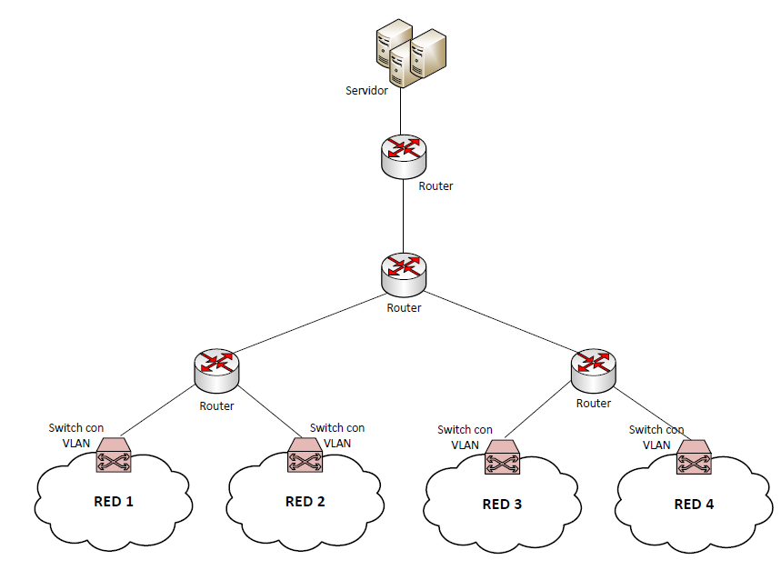

# Configuración previa

Vagrant es una aplicación libre que usa el lenguaje Ruby para facilitar la
creación y personalización de entornos virtuales de desarrollo. Vagrant nos
abstrae del sistema de virtualización subyacente y nos permite instalar y
configurar el software de la máquina virtual, que puede ejecutarse con
distintos gestores de máquinas virtuales, como VirtualBox o VMware [1][2].

Para empezar, hemos instalado VirtualBox 7.2 [3] y Vagrant desde los
repositorios oficiales de Oracle y de HashiCorp en nuestro equipo: un AMD
Ryzen 7 7700X con 30 GiB de RAM y Ubuntu 24.04. Podemos comprobar si se ha
instalado correctamente consultando la versión con el siguiente comando en la
terminal:

```
vagrant -v
```

Para que VirtualBox funcionara tuvimos que actualizar a la versión 7.2, porque
la 7.1 no era compatible con nuestro kernel, y desactivar el arranque seguro
(Secure Boot), que impedía cargar su módulo. Además, VirtualBox y KVM no pueden
usar a la vez la virtualización del procesador, así que antes de usar una
parte de la práctica hay que apagar las máquinas de la otra.

En esta práctica vamos a editar el `Vagrantfile`, que contiene el tipo de
máquina virtual y su configuración. En Vagrant se usan “boxes”, que son las
imágenes base a partir de las cuales se crean las máquinas virtuales. El
`Vagrantfile` se puede compartir para replicar el mismo entorno en otros
equipos, lo que proporciona portabilidad.

Para la segunda parte usaremos QEMU-KVM y libvirt, que permite definir las
máquinas virtuales mediante ficheros XML y gestionarlas con el comando `virsh`
[6]. Las dependencias del anfitrión las instala nuestro propio script:

```
sudo ./despliegue.py instalar
```

Como base de las máquinas hemos descargado del Moodle la imagen de disco
«maestro» (Ubuntu 20.04, usuario `root` y contraseña `agr`) y su fichero XML.
Todo el código está en el repositorio
<https://github.com/PabloElviraCalatayud/AGR>.

# Script de Vagrant en Ruby

En este apartado se nos ha pedido crear un script Vagrant (en lenguaje Ruby)
para desplegar una máquina virtual Linux en la que se ejecute un servidor web
Node.js, en nuestro caso SSR-master-server [4]. Debe ser accesible por el
puerto exterior 8080 y por el puerto 3000 en la propia máquina virtual.

Además, hemos querido que la máquina tenga el teclado en español y que, al
iniciar sesión, se imprima la configuración del servidor.

```{.ruby include="parte1-vagrant/Vagrantfile"}
```

El script desarrollado despliega un servidor web Node.js sobre una máquina
virtual Linux. A continuación se detallan sus bloques funcionales:

## Virtualización y sistema base

Imagen (box): `bento/ubuntu-22.04`, una versión LTS compatible con Node.js 22.
Se han asignado 1024 MB de RAM y 1 CPU. La máquina es un clon enlazado: sólo
guarda sus diferencias respecto a la imagen base.

## Arquitectura de red avanzada (multihoming)

La máquina es un equipo *multi-homed*, conectado a varias redes con varias
interfaces [5], como un servidor real con red de servicio y de gestión:

- Interfaz NAT: acceso a Internet y redirección del puerto 3000 de la máquina al 8080 del anfitrión.
- Red privada de servicio (192.168.56.10) y red privada de gestión (192.168.57.10), ambas host-only.
- Red pública opcional en modo puente, con `BRIDGE_IF=<interfaz> vagrant up`.

## Aprovisionamiento idempotente

Cuatro scripts de shell, que pueden repetirse sin errores ni duplicidades:

- Sistema: teclado español, idioma, zona horaria y cortafuegos `ufw` (sólo SSH y puerto 3000).
- Node: instala Node.js 22 desde NodeSource si no está instalado.
- Servidor: `git clone` del proyecto (o `git pull` si ya existe) y `npm install`.
- Inicio de sesión: en cada `vagrant ssh` imprime la configuración del sistema, la red y el servidor.

## Gestión del servicio mediante systemd

En lugar de `nohup`, el servidor es un servicio de systemd [11]: arranca con la
máquina, se reinicia si falla y usa un usuario sin privilegios. Se lanza con
`node app.js`, porque `npm start` falla con `EADDRINUSE`.

Finalmente, para lanzar la máquina virtual introducimos los siguientes
comandos en la terminal, en el directorio del `Vagrantfile`:

```
vagrant up
vagrant ssh
```

Con la máquina iniciada, la web se abre en `http://localhost:8080` desde el
anfitrión y en `http://localhost:3000` desde la máquina.

# Estudio del consumo de memoria

Hemos medido el consumo en el anfitrión (`ps`, `VBoxManage metrics`) y en la
máquina (`free`, `top`), en reposo y con 5000 peticiones al servidor. Como
propone el enunciado, vigilamos el crecimiento de la imagen con:

```
watch "ls -al ~/VirtualBox\ VMs/agr-nodeserver/Snapshots/"
```

### Consumo de memoria (RAM)

El sistema operativo y el servidor Node.js consumen apenas 202 MB dentro de la
máquina, un 20 % de los 1024 MB asignados. Sin embargo, al anfitrión le cuesta
toda la RAM asignada más la sobrecarga de VirtualBox (1.04 GiB), porque la
memoria libre se usa como caché y no se devuelve. Podríamos asignar 512 MB sin
afectar al rendimiento.

### Consumo de CPU

En reposo es prácticamente nulo (0.06 % del anfitrión). Con carga, la máquina
sirvió 122 peticiones por segundo y al anfitrión sólo le costó un 2.3 % de CPU.

### Almacenamiento

La imagen base (811 MB) se guarda una sola vez y la máquina sólo almacena sus
diferencias (2.1 GB). Con `watch` vimos que la imagen no crecía de forma
apreciable durante la carga: cada registro ocupa entre 50 y 80 bytes.

### Red virtualizada del laboratorio

El laboratorio 3103 completo (4 routers, 2 servidores y 32 PC) son 38 máquinas.
Con VirtualBox y 1 GB cada una necesitaría 41 GB de RAM y no cabría en nuestro
equipo (30 GB). En la segunda parte lo hemos medido con KVM:

| Escenario | Máquinas | RAM | Disco |
|---|---|---|---|
| Reducida, 1 GB (KVM, medido) | 9 | 6.1 GB | 4.5 GB |
| Completo, 512 MB (KVM, medido) | 38 | 19.2 GB | 8.0 GB |
| Completo, 1 GB (VirtualBox, estimado) | 38 | 41 GB | 77 GB |

Con 512 MB por máquina cabe y supera todas las pruebas, pero deja sólo 6.8 GB
libres: el recurso que limita es la memoria, no la CPU.

### Comparación con servidores comerciales

Un servidor actual con dos AMD EPYC 9005 [12] alcanza 768 hilos y varios
terabytes de RAM: con 1 TB alojaría unas 47 copias del laboratorio completo con
512 MB por máquina. Los contenedores serían aún más eficientes.

# Virtualización de infraestructura de red con KVM

Se nos ha pedido desarrollar el script que despliegue la siguiente red
empleando la tecnología QEMU-KVM:

{width="55%"}

El script debe generar los XML de las máquinas virtuales, instalar la Software
Routing Suite en los routers con las rutas estáticas necesarias para la
conectividad global y desplegar un servicio web en el servidor, al que deben
acceder las máquinas de las redes inferiores y el anfitrión.

## Plan de numeración

Hemos seguido el plano del laboratorio 3103 del Moodle. La red tiene 9
máquinas: los routers RA, RB, RC y RD, el servidor web SRV (10.100.0.11) y un PC
en cada red inferior (10.0.N.10). El anfitrión hace de PC del profesor
(10.200.0.2). En cada red el router tiene la dirección .1; las redes de PC son
/24 y los enlaces entre routers /30. Cada red es un *bridge* de Linux en el
anfitrión, y las tarjetas de cada máquina se llaman `eth0`, `eth1` y `eth2` en
el orden de su XML. El dibujo de la red aparece tras las tablas de enrutamiento.

## Tablas de enrutamiento

Los routers de los extremos sólo necesitan una ruta por defecto hacia RB, que
es el único que conoce las redes de cada rama. Bastan 8 rutas estáticas, las
del plano, configuradas con FRR [9] y guardadas en `/etc/frr/frr.conf`:

| Router | Destino | Siguiente salto |
|---|---|---|
| RA | 0.0.0.0/0 | 10.1.0.2 (RB) |
| RB | 10.0.1.0/24 y 10.0.2.0/24 | 10.2.0.2 (RC) |
| RB | 10.0.3.0/24 y 10.0.4.0/24 | 10.3.0.2 (RD) |
| RB | 0.0.0.0/0 | 10.1.0.1 (RA) |
| RC | 0.0.0.0/0 | 10.2.0.1 (RB) |
| RD | 0.0.0.0/0 | 10.3.0.1 (RB) |

Este es el dibujo de nuestra red, con el bridge, la tarjeta, el puerto del
plano y la dirección de cada conexión:


## Script de despliegue

Para este apartado hemos escrito el script `despliegue.py` en Python, con la
librería lxml para los XML [7]:

```{.python include="parte2/despliegue.py"}
```

Sus bloques funcionales son: el plan de numeración (diccionarios `REDES` y
`VMS`); la preparación del anfitrión (KVM, los 9 bridges y la dirección y rutas
del PC del profesor); la generación de los XML con lxml a partir de la plantilla
de Moodle (nombre, disco y una tarjeta por bridge); el molde, donde se instala
una sola vez el software común con `virt-customize` [8]; el disco diferencial de
cada máquina, con su nombre, sus IP y, en los routers, sus rutas de FRR; la
gestión con `virsh` y `xterm`, y los mensajes con `print` y `logging` [10], cuyas
trazas sólo aparecen con `-v`. Con `--completo` se añaden SRV2 y 7 PC más por
red, cuya configuración de red se genera a partir del plan.

## Despliegue de la red

Después hemos introducido los siguientes comandos en la terminal para preparar
el molde y desplegar toda la red:

```
sudo ./despliegue.py molde
sudo ./despliegue.py crear
```

El comando `crear` crea los bridges y las 9 máquinas, espera a que estén
listas y muestra su estado:

{width="46%"}

## Configuración de cada máquina

Antes de automatizarla, configuramos y comprobamos la red a mano, máquina a
máquina, con la misma configuración que aplica el script. En cada captura se
ven las interfaces y las rutas de la máquina (en los routers, también la tabla
de FRR) y, al final, el resultado de hacer ping a las 18 direcciones de la red
y de pedir la página web al servidor. Las capturas están en este orden, de
izquierda a derecha y de arriba abajo: RA, RB, RC, RD, servidor, PC1, PC2, PC3 y
PC4:

{width="32%"} {width="32%"} {width="32%"}

{width="32%"} {width="32%"} {width="32%"}

{width="32%"} {width="32%"} {width="32%"}

## Plan de pruebas

Durante la construcción probamos cada paso con ping y `traceroute`. Para la
prueba final, la orden `probar` comprueba el ping a todas las direcciones de la
red y el acceso web desde el anfitrión y desde cada máquina, el `traceroute` a
cada PC y las rutas de FRR de cada router:

```
sudo ./despliegue.py probar --informe /tmp/pruebas.txt
```

El resultado son 36 pruebas correctas de 36:

{width="34%"}

El `traceroute` hasta PC4 pasa por RA, RB y RD, el camino de las tablas de
enrutamiento.

## Consumo, configuraciones adicionales e incidencias

Las 9 máquinas ocupan 6.1 GB de RAM y 4.5 GB de disco. Con `--completo`, el
laboratorio completo (38 máquinas con 512 MB) ocupó 19.2 GB y 8 GB y superó las
94 pruebas. Además, FRR vuelve a aplicar su configuración al arrancar, porque
la principal incidencia fue que se perdían las rutas al reiniciar la red.

# Anexo

[1] HashiCorp, "Vagrant Documentation". [En línea]. Disponible: https://developer.hashicorp.com/vagrant/docs

[2] R. Ruiz, "Entornos virtuales de desarrollo con Vagrant", Raulr.net. [En línea]. Disponible: https://www.raulr.net/Entornos-virtuales-desarrollo-Vagrant/

[3] Oracle, "Oracle VirtualBox User Guide". [En línea]. Disponible: https://www.virtualbox.org/manual/

[4] GISAI, "SSR-master-server", GitHub. [En línea]. Disponible: https://github.com/gisai/SSR-master-server

[5] F5, "What Is Multi-Homing?", F5. [En línea]. Disponible: https://www.f5.com/glossary/multi-homing

[6] libvirt, "virsh — management user interface". [En línea]. Disponible: https://www.libvirt.org/manpages/virsh.html

[7] lxml, "The lxml.etree Tutorial". [En línea]. Disponible: https://lxml.de/tutorial.html

[8] libguestfs, "virt-customize — Customize a virtual machine". [En línea]. Disponible: https://libguestfs.org/virt-customize.1.html

[9] FRRouting, "Static Route Commands (staticd)". [En línea]. Disponible: https://docs.frrouting.org/en/latest/static.html

[10] Python Software Foundation, "logging — Logging facility for Python". [En línea]. Disponible: https://docs.python.org/3/library/logging.html

[11] systemd, "systemd.service — Service unit configuration". [En línea]. Disponible: https://www.freedesktop.org/software/systemd/man/latest/systemd.service.html

[12] AMD, "AMD EPYC 9005 Series Processors". [En línea]. Disponible: https://www.amd.com/en/products/processors/server/epyc/9005-series.html
