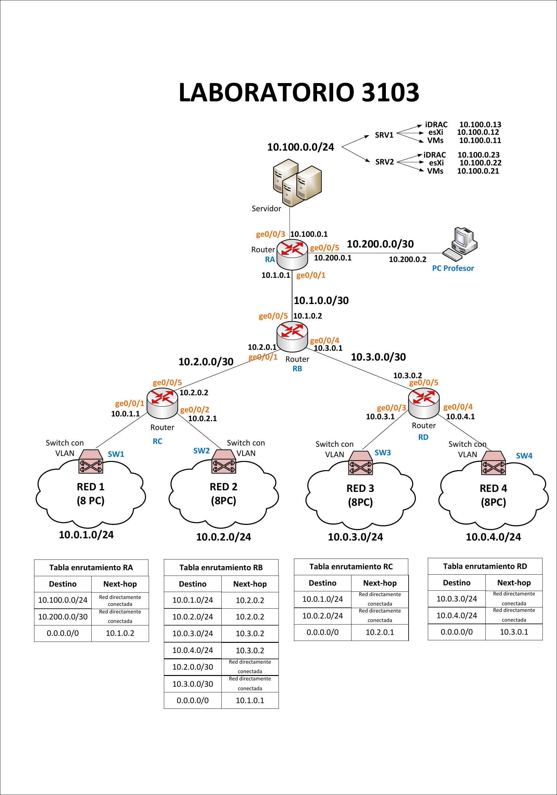
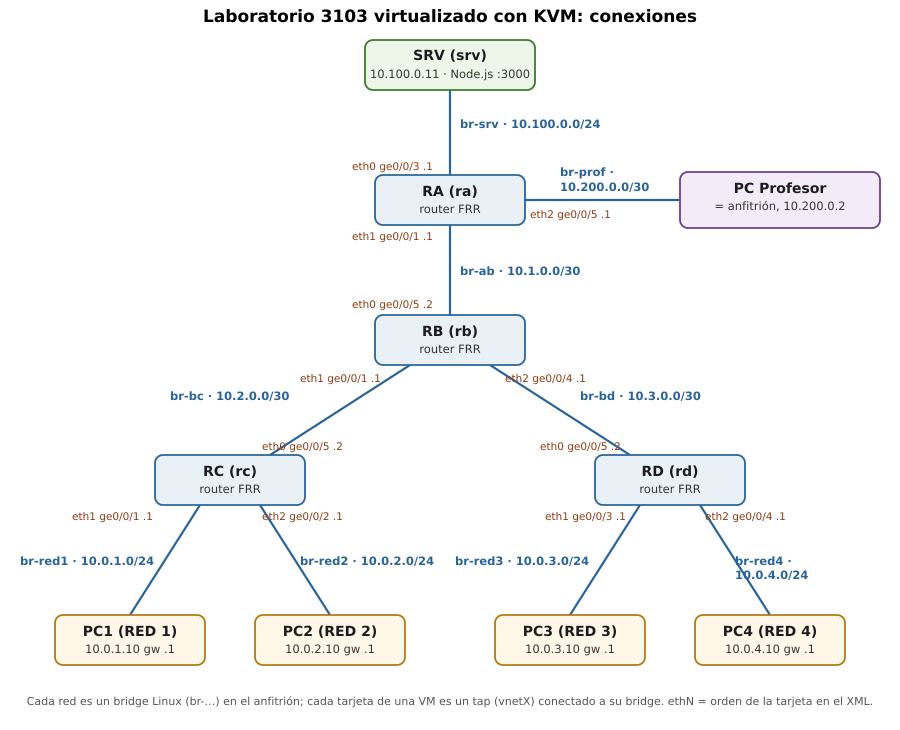

# 1. Configuración previa

## 1.1. Equipo anfitrión

Las dos partes de la práctica se han realizado en el mismo equipo físico:

| Elemento | Valor |
|---|---|
| Procesador | AMD Ryzen 7 7700X, 8 núcleos / 16 hilos, con AMD-V |
| Memoria | 30 GiB de RAM |
| Sistema operativo | Ubuntu 24.04 (Linux) |
| Parte 1 | VirtualBox 7.2.20 y Vagrant 2.4.9 |
| Parte 2 | QEMU-KVM, libvirt y libguestfs (`virt-customize`) |

Todo el material está en un repositorio Git autocontenido:

```
.
├── parte1-vagrant/Vagrantfile    Parte 1: script Vagrant (Ruby)
├── parte2/                       Parte 2: script de despliegue con QEMU-KVM
│   ├── despliegue.py             script (Python + lxml)
│   ├── plantilla.xml             XML de Moodle
│   ├── molde/                    software común de las VMs
│   └── vm/<vm>/                  configuración de dentro de cada VM
└── doc/
    ├── entregables/              esta memoria (PDF) y sus fuentes
    └── development/              enunciado, plano, medidas y capturas
```

## 1.2. Vagrant y VirtualBox (parte 1)

Vagrant es una herramienta libre que, a partir de un fichero escrito en Ruby
(el `Vagrantfile`), crea, configura y aprovisiona máquinas virtuales de forma
reproducible [1][2][3]. Vagrant se abstrae del hipervisor que hay debajo
(VirtualBox, VMware, Hyper-V…). Las VMs se crean a partir de una *box*: una
imagen base empaquetada que se descarga una vez y se reutiliza. El mismo
`Vagrantfile` sirve para replicar el mismo entorno en cualquier otro equipo.
Como hipervisor se ha usado VirtualBox [4].

Instalación en Ubuntu, desde los repositorios oficiales de Oracle y de
HashiCorp:

```bash
# VirtualBox
wget -O- https://www.virtualbox.org/download/oracle_vbox_2016.asc \
  | sudo gpg --dearmor --yes -o /usr/share/keyrings/oracle-virtualbox-2016.gpg
echo "deb [arch=amd64 signed-by=/usr/share/keyrings/oracle-virtualbox-2016.gpg] https://download.virtualbox.org/virtualbox/debian $(lsb_release -cs) contrib" \
  | sudo tee /etc/apt/sources.list.d/virtualbox.list
sudo apt update && sudo apt install -y virtualbox-7.2 build-essential dkms linux-headers-$(uname -r)
sudo usermod -aG vboxusers $USER

# Vagrant
wget -O- https://apt.releases.hashicorp.com/gpg \
  | sudo gpg --dearmor --yes -o /usr/share/keyrings/hashicorp-archive-keyring.gpg
echo "deb [arch=$(dpkg --print-architecture) signed-by=/usr/share/keyrings/hashicorp-archive-keyring.gpg] https://apt.releases.hashicorp.com $(lsb_release -cs) main" \
  | sudo tee /etc/apt/sources.list.d/hashicorp.list
sudo apt update && sudo apt install -y vagrant
```

Se comprueba la instalación consultando las versiones:

```
$ vagrant -v
Vagrant 2.4.9
$ VBoxManage --version
7.2.20r175154
```

Antes de que VirtualBox funcionara hubo que resolver tres problemas del
anfitrión:

| Problema | Causa | Solución |
|---|---|---|
| `No usable default provider` y VirtualBox 7.1 sin módulo del kernel | El kernel del anfitrión era demasiado nuevo para VirtualBox 7.1 | Actualizar a VirtualBox 7.2 |
| `modprobe vboxdrv` rechazado | Secure Boot activo, con el módulo firmado con una clave no registrada | Desactivar Secure Boot en la BIOS (o registrar la clave MOK) y ejecutar `sudo /sbin/vboxconfig` |
| `VERR_SVM_IN_USE` / `VERR_VMX_IN_VMX_ROOT_MODE` | KVM ocupa la virtualización del procesador (AMD-V/VT-x) | Descargar `kvm_amd` y `kvm` antes de `vagrant up`. El `Vagrantfile` lo hace solo (sección 2.3) |

## 1.3. QEMU-KVM y libvirt (parte 2)

KVM es el hipervisor integrado en el kernel de Linux. QEMU emula el resto del
hardware de la VM y libvirt ofrece una interfaz común para definir y
gestionar las VMs: ficheros XML de definición y la orden `virsh` [8][9]. Para
preparar los discos sin arrancar las VMs se usan `qemu-img` [11] y
`virt-customize` [12].

Las dependencias del anfitrión las instala el propio script de la parte 2:

```bash
sudo ./despliegue.py instalar
# = apt-get install qemu-system-x86 qemu-utils libvirt-daemon-system libvirt-clients \
#     libguestfs-tools isc-dhcp-client python3-lxml bridge-utils xterm traceroute \
#     openssh-client curl
```

Como aconseja el enunciado, se parte de la **imagen de disco «maestro» y el
fichero XML de Moodle**: Ubuntu 20.04 LTS con el superusuario `root` y la
contraseña `agr`. La imagen se copia, sin modificarla, como
`/var/lib/libvirt/images/lab3103/base.qcow2`. El XML se guarda como
`parte2/plantilla.xml`.

KVM y VirtualBox no pueden usar la virtualización del procesador a la vez:
el `Vagrantfile` descarga KVM antes de arrancar y `despliegue.py` descarga
VirtualBox antes de arrancar las VMs de la parte 2.

# 2. Script de Vagrant en Ruby

Se pide un script Vagrant (Ruby) que despliegue una máquina virtual Linux con
un servidor web Node.js, en concreto **SSR-master-server** [5]. El script debe
instalar Node.js, descargar el código de GitHub y ejecutarlo. El servidor debe
ser accesible **en el puerto 3000 desde la propia VM** y **en el 8080 desde el
exterior**, mediante redirección de puertos, y la VM debe tener una dirección
de red acorde al tipo de conexión elegido. Se valora explorar configuraciones
adicionales, como varias interfaces de red en la misma VM.

A esto se han añadido dos requisitos propios: **teclado en español** e
**imprimir la configuración del servidor al iniciar sesión**.

## 2.1. Código: `parte1-vagrant/Vagrantfile`

```{.ruby include="parte1-vagrant/Vagrantfile"}
```

## 2.2. Explicación del script

El script se organiza en **parámetros**, cuatro **scripts de
aprovisionamiento** en Bash y la **definición de la VM**. Estos son sus
bloques funcionales:

### 1. Virtualización y sistema base

- **Box `bento/ubuntu-22.04`** (Ubuntu 22.04 LTS). Una versión LTS
  garantiza soporte y compatibilidad con Node.js 22.
- **1 vCPU y 1024 MB de RAM**, parametrizables con las variables de entorno
  `VM_CPUS` y `VM_MEMORY`. Con `--cpuexecutioncap 80` la VM no puede usar más
  del 80 % de una CPU del anfitrión. El estudio de consumo (sección 3) muestra
  que estos recursos sobran.
- **Clon enlazado** (`linked_clone`): la VM no copia la box, sólo guarda sus
  diferencias. Ahorra disco y acelera la creación.
- Nombre `agr-nodeserver`, como VM de VirtualBox y como hostname.

### 2. Arquitectura de red avanzada (multihoming)

La VM es un equipo *multi-homed* [3], con **cuatro interfaces de red**, como
un servidor real que tiene una red de servicio, otra de gestión y salida a
Internet:

| Interfaz | Tipo | Dirección | Uso |
|---|---|---|---|
| eth0 (`enp0s3`) | NAT | 10.0.2.15 (DHCP de VirtualBox) | Salida a Internet para instalar paquetes. **Port forwarding `anfitrión:8080 → VM:3000`** en todas las interfaces del anfitrión, por lo que el servicio es accesible también desde otros equipos de la LAN |
| eth1 | Privada (host-only) | 192.168.56.10/24 | Red del servicio web: `http://192.168.56.10:3000` |
| eth2 | Privada (host-only) | 192.168.57.10/24 | Red de gestión |
| eth3 (opcional) | Pública (bridge) | DHCP de la LAN | Sólo con `BRIDGE_IF=<interfaz> vagrant up` |

```
                    Internet
                       |
                  [NAT VirtualBox]  anfitrión:8080 ──► VM:3000
                       |
        ┌──────────── eth0 (enp0s3, 10.0.2.15) ────────────┐
        │                agr-nodeserver                     │
        │   eth1 192.168.56.10/24     eth2 192.168.57.10/24  │
        └─────────┬───────────────────────────┬──────────────┘
          vboxnet0 (servicio)         vboxnet1 (gestión)
                  │                           │
             anfitrión                    anfitrión
          192.168.56.1                 192.168.57.1
          (+ eth3 bridge opcional, IP por DHCP de la LAN)
```

### 3. Aprovisionamiento idempotente

Cuatro *provisioners* de tipo `shell` automatizan la instalación. Son
idempotentes: `vagrant provision` puede repetirse sin errores ni duplicidades.

| Provisioner | Qué hace |
|---|---|
| `sistema` | **Teclado español** en consola y X11 (`/etc/default/keyboard`, `setupcon`, `localectl`, `loadkeys es`), locale `es_ES.UTF-8` y zona horaria `Europe/Madrid`. Instala los paquetes base y configura el cortafuegos `ufw`: deniega todo lo entrante salvo 22/tcp (SSH) y 3000/tcp (web) |
| `node` | Instala Node.js 22 desde el repositorio oficial de NodeSource [6], sólo si no está ya instalada esa versión |
| `servidor` | Crea el usuario sin privilegios `nodeapp`. Hace `git clone` del servidor en `/opt/ssr-master-server`, o `git pull` si ya existe. Ejecuta `npm install --omit=dev`. Crea y arranca el servicio systemd y espera a que el puerto 3000 responda |
| `login-info` | Desactiva el MOTD de Ubuntu e instala `/etc/profile.d/99-servidor-info.sh` |

Todos los scripts empiezan con `set -euo pipefail`: si un paso falla, el
aprovisionamiento se detiene en lugar de continuar con un sistema a medias.

### 4. Gestión del servicio con systemd

El servidor no se lanza con `nohup` sino como unidad **systemd**
`ssr-server.service` [7]:

- **Persistencia:** `systemctl enable` hace que arranque con la VM.
- **Resiliencia:** `Restart=on-failure` lo vuelve a levantar si se detiene
  por un error.
- **Seguridad:** se ejecuta con el usuario `nodeapp`, sin privilegios.
- **Operatividad:** se gestiona con `systemctl start|stop|status|restart
  ssr-server` y `journalctl -u ssr-server`.

**Incidencia del servidor:** `app.js` ya ejecuta `app.listen(3000)`, y
`bin/www`, que es lo que lanza `npm start`, vuelve a escuchar en el mismo
puerto. Por eso `npm start` termina con `EADDRINUSE`. El servicio ejecuta
directamente `node app.js`.

### 5. Configuración del servidor al iniciar sesión

`/etc/profile.d/99-servidor-info.sh` se ejecuta en cada inicio de sesión
interactivo (`vagrant ssh`) e imprime:

- **sistema:** hostname, SO, kernel, CPUs, memoria, disco, carga, teclado y
  zona horaria;
- **red:** IPs de cada interfaz, puerta de enlace y DNS;
- **servidor web:** estado del servicio (ACTIVO o DETENIDO), ruta del código,
  versiones de Node.js y npm, URLs de acceso desde la VM, la red privada y el
  anfitrión, y puertos en escucha;
- **cortafuegos:** reglas de `ufw`;
- comandos útiles y un ejemplo de petición a `/record`.

### 6. Preparación del anfitrión

Un *trigger* `before [:up, :reload, :resume]` descarga los módulos de KVM si
están cargados y carga `vboxdrv`. Así la VM arranca aunque se haya usado
antes la parte 2. Si hay VMs de KVM encendidas, avisa de cómo apagarlas.

## 2.3. Despliegue y comprobación

Para lanzar la VM, desde la carpeta del `Vagrantfile`:

```bash
cd parte1-vagrant
vagrant up        # crea y aprovisiona la VM
vagrant ssh       # entra en la VM: se imprime la configuración del servidor
```

Al terminar `vagrant up` se muestran las tres formas de acceder:

```
VM agr-nodeserver lista.
  - Desde el anfitrión:   http://localhost:8080
  - Por la red privada:   http://192.168.56.10:3000
  - Dentro de la VM:      http://localhost:3000
Entre con "vagrant ssh" para ver la configuración del servidor.
```

Pruebas realizadas:

| Prueba | Orden | Resultado |
|---|---|---|
| Servicio desde la VM (puerto 3000) | `vagrant ssh -c "curl -s localhost:3000"` | HTML del Data-Logger |
| Acceso exterior (puerto 8080) | `curl http://localhost:8080` en el anfitrión, o el navegador | HTTP 200, página del Data-Logger |
| Red privada | `curl http://192.168.56.10:3000` | HTTP 200 |
| Escritura de datos | `curl "localhost:8080/record?id_nodo=n1&temperatura=24.5&humedad=60&co2=300&volatiles=100"` | `Saving: ...` y un CSV nuevo en `/logs` |
| Carga | 20 000 + 5000 peticiones a `/record` | 53 CSV generados, sin errores |
| Información al iniciar sesión | `vagrant ssh` | Se imprime la configuración del servidor |
| Teclado | Consola de VirtualBox (`VM_GUI=true vagrant up`) | Distribución española |

# 3. Estudio del consumo de memoria y CPU

Para valorar el coste del servicio virtualizado se midió en tiempo real,
tanto en el anfitrión como dentro de la VM `agr-nodeserver`: Ubuntu 22.04,
1 vCPU, 1 GB de RAM, Node.js 22 y SSR-master-server.

**Metodología:**

- Desde el anfitrión: `ps` del proceso de la VM, `VBoxManage metrics` y
  `du` de la carpeta de la VM.
- Desde la VM: `free`, `df`, `top` y `ps` del proceso `node`.
- Escenarios: en reposo y durante una carga de 5000 peticiones HTTP
  secuenciales a `/record` a través del port forwarding
  (`localhost:8080 → VM:3000`). Antes se habían enviado unas 20 000
  peticiones.
- Crecimiento de la imagen vigilado con `watch`, como propone el enunciado:

```bash
watch "ls -al ~/VirtualBox\ VMs/agr-nodeserver/Snapshots/"
```

Los datos en bruto están en `doc/development/parte1/consumo_raw.txt`.
Extracto literal, en reposo y con carga. Las líneas `VBoxHeadless` y
`agr-nodeserver …` se tomaron en el anfitrión (`ps` y `VBoxManage metrics`);
`Mem:`, `df`, `node` y `top`, dentro de la VM:

```
===== VM EN REPOSO =====
    PID   RSS    VSZ %CPU %MEM     ELAPSED CMD
  10423 1095328 3201216 3.4  3.4     56:19 /usr/lib/virtualbox/VBoxHeadless --comment agr-nodeserver ...
agr-nodeserver  CPU/Load/User                            0.00%, 0.06%, 0.00%, 0.06%, 0.06%
agr-nodeserver  CPU/Load/Kernel                          0.00%, 0.00%, 0.00%, 0.00%, 0.06%
agr-nodeserver  RAM/Usage/Used                           1093860 kB (x5)
agr-nodeserver  Guest/CPU/Load/User                      0.00% (x5)
agr-nodeserver  Guest/CPU/Load/Kernel                    0.00% (x5)
agr-nodeserver  Guest/RAM/Usage/Total                    980396 kB
agr-nodeserver  Guest/RAM/Usage/Free                     719280 kB
agr-nodeserver  Guest/RAM/Usage/Cache                    647532 kB
 21:18:06 up 58 min,  1 user,  load average: 0.04, 0.03, 0.01
Mem:           957Mi       202Mi        69Mi       0.0Ki       685Mi       600Mi
Swap:          2.9Gi       3.0Mi       2.9Gi
/dev/mapper/ubuntu--vg-ubuntu--lv   31G  5.5G   24G  19% /
820K	/opt/ssr-master-server/public/logs   (53 ficheros CSV)
  RSS %CPU %MEM CMD
86548  0.5  8.8 /usr/bin/node app.js

===== VM CON CARGA (5000 peticiones) =====
  10423 1097028 3201216 3.5  3.4
agr-nodeserver  CPU/Load/User                            2.03%, 2.09%, 2.15%, 2.02%, 2.21%
agr-nodeserver  CPU/Load/Kernel                          0.19%, 0.12%, 0.12%, 0.18%, 0.12%
agr-nodeserver  RAM/Usage/Used                           1094116 kB .. 1095396 kB
agr-nodeserver  Guest/CPU/Load/User                      5.00%, 19.00%, 17.00%, 15.00%, 17.00%
agr-nodeserver  Guest/CPU/Load/Kernel                    4.00%, 9.00%, 7.00%, 8.00%, 7.00%
top: %Cpu(s):  7.7 us, 15.4 sy, 76.9 id
MiB Mem :    957.4 total,     71.1 free,    206.1 used,    680.3 buff/cache
  19913 nodeapp   20   0 1265048  87860  54252 S  26.7   9.0   0:19.20 node
Duracion carga: 40.883551254 s para 5000 peticiones
```

## 3.1. Memoria (RAM)

| Medida | Reposo | Con carga | Tras carga |
|---|---|---|---|
| RSS del proceso `VBoxHeadless` (anfitrión) | **1.04 GiB** | 1.05 GiB | 1.05 GiB |
| RAM usada por el invitado (sin caché) | 202 MiB | 206 MiB | 204 MiB |
| Caché de disco del invitado | 685 MiB | 680 MiB | 692 MiB |
| RSS del proceso `node app.js` | 85 MiB | 86 MiB | — |

- La aplicación es ligera: el sistema operativo y el servidor usan unos
  **200 MiB** (un 20 % de la RAM asignada), y Node.js unos 85 MiB.
- Sin embargo, **al anfitrión la VM le cuesta toda la RAM asignada (1 GB)
  más unos 70 MiB de sobrecarga de VirtualBox**. El invitado usa la memoria
  libre como caché de disco y VirtualBox no la devuelve. En virtualización
  completa se paga la RAM *reservada*, no la *necesaria*.
- La carga apenas mueve la memoria (+10 MiB): el servidor no acumula estado.
- Se podría asignar **512 MiB** sin afectar al servicio, y el coste se
  reduciría a la mitad.

## 3.2. CPU

| Medida | Reposo | Con carga |
|---|---|---|
| CPU del anfitrión usada por la VM | ~0.06 % | **~2.3 %** (≈ 0.37 de 16 hilos) |
| CPU del invitado (usuario + kernel) | 0 % | ~24 % de 1 vCPU |
| `node` en `top` | 0.5 % | 26.7 % |

- En reposo la sobrecarga de la virtualización es despreciable.
- Con carga se sirvieron **5000 peticiones en 40.9 s (~122 peticiones/s,
  ~8 ms por petición)**. El cuello de botella no es el servidor (vCPU al
  24 %) sino el cliente: un `curl` nuevo por petición, en serie. Con
  clientes concurrentes, la VM admitiría bastante más tráfico antes de
  saturar su vCPU.
- Aproximadamente un tercio del coste es del kernel, por la red virtual NAT y
  por la escritura en disco de cada petición.

## 3.3. Disco y crecimiento de la imagen

| Elemento | Tamaño |
|---|---|
| Box base `bento/ubuntu-22.04` (`~/.vagrant.d/boxes`) | 811 MiB |
| Disco diferencial de la VM (clon enlazado, `Snapshots/*.vmdk`) | **2.1 GiB** |
| Uso dentro del invitado | 5.5 GiB de 31 GiB virtuales |
| Logs CSV tras ~25 000 registros | 1.2 MiB (53 ficheros) |

- Con el clon enlazado, la box se guarda una sola vez y la VM sólo almacena
  sus diferencias (paquetes, Node.js, `node_modules` y logs). Una segunda VM
  igual costaría otros 2 GiB aproximadamente, no 5.5.
- El disco es *dinámico*: los 31 GiB son un máximo y el fichero crece al
  escribirse bloques nuevos. Durante la carga, `watch` mostró que el `.vmdk`
  no cambiaba de forma visible (seguía en 2.1 GiB):
  - los datos generados (unos 0.4 MiB, de 50 a 80 B por registro) son
    despreciables frente a la granularidad de bloques del disco virtual;
  - al ritmo medido harían falta alrededor de un millón de registros para que
    creciera entre 50 y 80 MiB.
- Si los datos se borran dentro de la VM, el `.vmdk` **no** encoge. Habría
  que compactarlo (`VBoxManage modifymedium --compact`).

## 3.4. Consumo de una réplica virtualizada del laboratorio

Según el plano del laboratorio (sección 4.1), éste tiene **4 routers**
(RA–RD), **2 servidores** en 10.100.0.0/24, el PC del profesor y **4 redes de
8 PC** (32 PC). Hay dos escenarios:

- **Réplica completa:** 4 routers + 2 servidores + 32 PC = **38 VMs**. El PC
  del profesor es el propio anfitrión.
- **Réplica reducida**, la desplegada en la parte 2, que el enunciado
  permite: 4 routers + 1 servidor + 1 PC por red = **9 VMs**.

Coste por VM según las medidas:

- **RAM:** unos 1.07 GiB en el anfitrión con 1 GB asignado.
- **CPU:** un 0.06 % en reposo.
- **Disco:** unos 2 GiB de disco diferencial, más los 811 MiB de la box
  compartida.

En la versión optimizada se asignan 256 MiB a routers y PC (unos 0.32 GiB
reales) y 512 MiB a los servidores (unos 0.57 GiB).

| Escenario | VMs | RAM anfitrión | Disco (clones enlazados) | CPU en reposo |
|---|---|---|---|---|
| Completa, 1 GB por VM | 38 | **~41 GiB** | ~77 GiB | ~2 % |
| Completa, optimizada | 38 | ~12.7 GiB | ~40 GiB | ~2 % |
| Reducida, 1 GB por VM | 9 | ~9.6 GiB | ~19 GiB | < 1 % |
| Reducida, optimizada | 9 | ~3.1 GiB | ~10 GiB | < 1 % |

- La réplica completa sin optimizar **no cabe** en el anfitrión (30 GiB de
  RAM). Optimizada, ocupa un 42 % de la RAM. La reducida cabe de sobra.
- **La RAM es el recurso limitante, no la CPU:** un router o un PC del
  laboratorio está ocioso casi siempre.
- El disco de cada VM crece sólo con sus cambios. Con imágenes `qcow2` con
  *backing file* (el equivalente KVM de los clones enlazados), los routers y
  PC ocupan poco más que la imagen base. La parte 2 lo confirma: unos 140 MB
  por VM y 6.1 GiB de RAM para las 9 VMs (sección 4.9).
- Con KVM, además, KSM (*Kernel Same-page Merging*) permite que VMs con el
  mismo sistema compartan páginas de memoria idénticas [18].

## 3.5. Comparación con servidores comerciales

Un servidor de rack actual de 2 sockets, con AMD EPYC serie 9005 o Intel
Xeon 6 [16][17], llega a **384 núcleos / 768 hilos y a varios TB de RAM**.
Con las cifras medidas, en un servidor de 1 TB de RAM y 768 hilos:

| Límite | Cálculo | VMs como ésta |
|---|---|---|
| RAM (dejando un 10 % al hipervisor) | 920 GiB / 1.07 GiB | **~860** |
| CPU con carga como la del ensayo | 768 hilos / 0.37 hilos | ~2000 |
| CPU en reposo | — | prácticamente ilimitado |

- De nuevo manda la RAM. Ese servidor alojaría **unas 22 réplicas
  completas** del laboratorio sin optimizar, o **unas 70** optimizadas. De
  la réplica reducida, unas 95 y unas 300 respectivamente.
- Frente al anfitrión de prácticas (16 hilos, 30 GiB), el servidor comercial
  tiene unas 48 veces más hilos y unas 33 veces más RAM.
- Para un servicio tan ligero, una VM completa desperdicia memoria. Con
  **contenedores** (Docker o LXC), que comparten el kernel del anfitrión,
  cada instancia costaría unos 100 MiB en lugar de 1 GiB: unas 10 veces más
  densidad. Las VMs compensan cuando hace falta aislamiento fuerte o un
  sistema propio, como los routers de la parte 2, que tienen su propia pila
  de red.

## 3.6. Conclusiones del estudio

1. El servidor Node.js necesita unos 200 MiB de RAM y muy poca CPU. La VM,
   en cambio, consume en el anfitrión toda la RAM asignada.
2. Dimensionar bien importa: con 512 MiB el coste se reduce a la mitad sin
   afectar al servicio.
3. Los clones enlazados y los discos dinámicos reducen mucho el disco
   ocupado. Los datos de la aplicación son despreciables.
4. Para replicar redes completas, la RAM es el cuello de botella. La CPU sólo
   importa con carga real.

# 4. Virtualización de infraestructura de red con KVM

## 4.1. Red a desplegar

Se pide un script que despliegue con QEMU-KVM la red del laboratorio 3103:


El script debe:

- generar los XML de las VMs, preferiblemente con `lxml`;
- instalar la **Software Routing Suite** en los routers y configurar las
  **rutas estáticas** para lograr conectividad global;
- desplegar un **servicio web** en el servidor.

Cualquier máquina de las redes inferiores, y también el anfitrión, debe
acceder al servicio web. Cada una de las cuatro subredes inferiores puede
ser un único PC.

El plano del laboratorio publicado en Moodle da las direcciones, los puertos
de los routers y sus tablas de enrutamiento:



## 4.2. Decisiones de diseño

| Decisión | Motivo |
|---|---|
| **Imagen de disco y XML de Moodle** como base (Ubuntu 20.04, `root`/`agr`) | Lo aconseja el enunciado: KVM y libvirt son sensibles a la versión del sistema |
| **9 VMs:** RA, RB, RC, RD, SRV y un PC por red (PC1–PC4) | El enunciado permite que cada subred inferior sea un único PC |
| **El plan de numeración es el del plano del laboratorio** | La réplica se comporta como la red real y las tablas de rutas son las del plano |
| **El anfitrión es el PC Profesor** (10.200.0.2/30, enlace con RA) | Es el equipo que el plano coloca en esa red. Además, las pruebas desde el anfitrión atraviesan toda la red, de RA hasta cada PC. El flujo de tráfico de las redes inferiores hacia el exterior se comprueba desde PC1–PC4 |
| Cada red es un **bridge Linux** del anfitrión | Hace de switch. Las tarjetas de las VMs son taps que libvirt conecta al bridge |
| **FRR 7.2.1** como Software Routing Suite | Está en los repositorios de Ubuntu 20.04. Su `vtysh` usa la sintaxis de Cisco IOS, como el plano [13][14] |
| **Cadena de discos qcow2** `base ← molde ← VM` | La imagen de Moodle no se modifica nunca. El software común se instala una sola vez en el molde, y cada VM sólo guarda sus diferencias |
| Configuración de cada VM **escrita en su disco antes de arrancarla** (`virt-customize`) | Las VMs arrancan ya configuradas: no hay que entrar por consola a configurarlas |
| Interfaces `eth0`, `eth1`, `eth2` en el orden del XML | La imagen arranca con `net.ifnames=0`, así que el orden de las `<interface>` del XML fija el nombre de cada tarjeta |

## 4.3. Plan de numeración



El plan sigue el del laboratorio:

- **10.100.0.0/24** para la red de servidores;
- **/30** para los enlaces punto a punto entre routers (10.1, 10.2 y 10.3) y
  para el del PC Profesor (10.200.0.0/30);
- **10.0.N.0/24** para cada red de PC.

En cada red, el router tiene la **.1**, el PC la **.10** y el servidor la
**.11**, que es la dirección de las VMs de SRV1 en el plano.

**Redes (bridges del anfitrión):**

| Bridge | Red del plano | Subred | Equipos conectados |
|---|---|---|---|
| `br-srv` | Red de servidores | 10.100.0.0/24 | SRV (eth0), RA (eth0) |
| `br-prof` | Enlace del PC Profesor | 10.200.0.0/30 | RA (eth2), anfitrión |
| `br-ab` | Enlace RA–RB | 10.1.0.0/30 | RA (eth1), RB (eth0) |
| `br-bc` | Enlace RB–RC | 10.2.0.0/30 | RB (eth1), RC (eth0) |
| `br-bd` | Enlace RB–RD | 10.3.0.0/30 | RB (eth2), RD (eth0) |
| `br-red1` | RED 1 (SW1) | 10.0.1.0/24 | RC (eth1), PC1 (eth0) |
| `br-red2` | RED 2 (SW2) | 10.0.2.0/24 | RC (eth2), PC2 (eth0) |
| `br-red3` | RED 3 (SW3) | 10.0.3.0/24 | RD (eth1), PC3 (eth0) |
| `br-red4` | RED 4 (SW4) | 10.0.4.0/24 | RD (eth2), PC4 (eth0) |

**Direcciones de cada equipo:**

| Equipo | Tarjeta | Puerto del plano | Bridge | IP | Puerta de enlace |
|---|---|---|---|---|---|
| **RA** | eth0 | ge0/0/3 | br-srv | 10.100.0.1/24 | — (router) |
| | eth1 | ge0/0/1 | br-ab | 10.1.0.1/30 | |
| | eth2 | ge0/0/5 | br-prof | 10.200.0.1/30 | |
| **RB** | eth0 | ge0/0/5 | br-ab | 10.1.0.2/30 | — (router) |
| | eth1 | ge0/0/1 | br-bc | 10.2.0.1/30 | |
| | eth2 | ge0/0/4 | br-bd | 10.3.0.1/30 | |
| **RC** | eth0 | ge0/0/5 | br-bc | 10.2.0.2/30 | — (router) |
| | eth1 | ge0/0/1 | br-red1 | 10.0.1.1/24 | |
| | eth2 | ge0/0/2 | br-red2 | 10.0.2.1/24 | |
| **RD** | eth0 | ge0/0/5 | br-bd | 10.3.0.2/30 | — (router) |
| | eth1 | ge0/0/3 | br-red3 | 10.0.3.1/24 | |
| | eth2 | ge0/0/4 | br-red4 | 10.0.4.1/24 | |
| **SRV** | eth0 | — | br-srv | 10.100.0.11/24 | 10.100.0.1 (RA) |
| **PC1** | eth0 | — | br-red1 | 10.0.1.10/24 | 10.0.1.1 (RC) |
| **PC2** | eth0 | — | br-red2 | 10.0.2.10/24 | 10.0.2.1 (RC) |
| **PC3** | eth0 | — | br-red3 | 10.0.3.10/24 | 10.0.3.1 (RD) |
| **PC4** | eth0 | — | br-red4 | 10.0.4.10/24 | 10.0.4.1 (RD) |
| **Anfitrión** | br-prof | — | br-prof | 10.200.0.2/30 | Rutas a las 8 redes del laboratorio vía 10.200.0.1 (RA) |

## 4.4. Tablas de enrutamiento

Los routers de los extremos (RA, RC y RD) sólo necesitan una **ruta por
defecto** hacia RB. RB es el único que conoce el detalle: las redes de PC de
cada rama y la ruta por defecto hacia RA, que lleva a la red de servidores
y al PC Profesor. En total son **8 rutas estáticas**, las del plano:

| Router | Destino | Siguiente salto | Interfaz | Motivo |
|---|---|---|---|---|
| **RA** | 0.0.0.0/0 | 10.1.0.2 (RB) | eth1 | Todo lo que no es suyo está detrás de RB |
| **RB** | 10.0.1.0/24 | 10.2.0.2 (RC) | eth1 | RED 1 |
| | 10.0.2.0/24 | 10.2.0.2 (RC) | eth1 | RED 2 |
| | 10.0.3.0/24 | 10.3.0.2 (RD) | eth2 | RED 3 |
| | 10.0.4.0/24 | 10.3.0.2 (RD) | eth2 | RED 4 |
| | 0.0.0.0/0 | 10.1.0.1 (RA) | eth0 | Servidores y PC Profesor |
| **RC** | 0.0.0.0/0 | 10.2.0.1 (RB) | eth0 | Única salida |
| **RD** | 0.0.0.0/0 | 10.3.0.1 (RB) | eth0 | Única salida |

Las rutas se configuran en FRR con `ip route <destino> <siguiente salto>` y se
guardan en `/etc/frr/frr.conf` (ver la sección 4.5.6). Las tablas que muestra
FRR (`vtysh -c 'show ip route'`) en la red desplegada por el script son las
siguientes. `S` indica una ruta estática, `C` una red directamente
conectada, y `*` que la ruta está instalada en el kernel:

**RA**

```
S>* 0.0.0.0/0 [1/0] via 10.1.0.2, eth1
C>* 10.1.0.0/30 is directly connected, eth1
C>* 10.100.0.0/24 is directly connected, eth0
C>* 10.200.0.0/30 is directly connected, eth2
```

**RB**

```
S>* 0.0.0.0/0 [1/0] via 10.1.0.1, eth0
S>* 10.0.1.0/24 [1/0] via 10.2.0.2, eth1
S>* 10.0.2.0/24 [1/0] via 10.2.0.2, eth1
S>* 10.0.3.0/24 [1/0] via 10.3.0.2, eth2
S>* 10.0.4.0/24 [1/0] via 10.3.0.2, eth2
C>* 10.1.0.0/30 is directly connected, eth0
C>* 10.2.0.0/30 is directly connected, eth1
C>* 10.3.0.0/30 is directly connected, eth2
```

**RC**

```
S>* 0.0.0.0/0 [1/0] via 10.2.0.1, eth0
C>* 10.0.1.0/24 is directly connected, eth1
C>* 10.0.2.0/24 is directly connected, eth2
C>* 10.2.0.0/30 is directly connected, eth0
```

**RD**

```
S>* 0.0.0.0/0 [1/0] via 10.3.0.1, eth0
C>* 10.0.3.0/24 is directly connected, eth1
C>* 10.0.4.0/24 is directly connected, eth2
C>* 10.3.0.0/30 is directly connected, eth0
```

Coinciden con las tablas del plano. RA tiene además directamente conectada la
red 10.1.0.0/30, que la tabla del plano no lista.

## 4.5. Script de despliegue: `parte2/despliegue.py`

El script está escrito en **Python 3** y usa **lxml** para los XML, como
recomienda el enunciado. Se apoya en estos ficheros del repositorio:

```
parte2/
├── despliegue.py            script de despliegue
├── plantilla.xml            XML de Moodle: base de los XML de todas las VMs
├── molde/
│   ├── preparar_molde.sh    software común: FRR, Node.js, servidor web, SSH
│   └── ssr-server.service   servicio systemd del servidor web
└── vm/<vm>/                 configuración de dentro de cada VM
    ├── interfaces           → /etc/network/interfaces
    ├── 99-router.conf       → /etc/sysctl.d/     (routers: reenvío IP)
    └── frr.conf             → /etc/frr/frr.conf  (routers: rutas estáticas)
```

Se usa con una orden por acción:

| Orden | Qué hace |
|---|---|
| `sudo ./despliegue.py instalar` | Instala las dependencias del anfitrión |
| `sudo ./despliegue.py molde` | Construye `molde.qcow2` sobre la imagen de Moodle con el software común |
| `sudo ./despliegue.py crear` | Prepara el anfitrión, crea discos y XML, ejecuta `virsh define` y `virsh start` y espera a que las VMs estén listas |
| `sudo ./despliegue.py probar [--informe f]` | Ejecuta el plan de pruebas de conectividad global |
| `sudo ./despliegue.py estado` | Estado y tarjetas de cada VM |
| `sudo ./despliegue.py consola ra rb …` | Abre un `xterm` con la consola de cada VM, en segundo plano |
| `sudo ./despliegue.py parar` / `arrancar` | `virsh shutdown` / `virsh start` |
| `sudo ./despliegue.py destruir` | `virsh destroy` y `undefine`. Borra los discos de las VMs, los bridges y las rutas, y conserva la imagen base y el molde |
| `./despliegue.py xml` | Sólo genera los XML en `parte2/xml/`. No necesita root |

Opciones: `-v` activa las trazas de depuración, `--ram MB` fija la RAM de
cada VM (por defecto, la de la plantilla) y `--proxy` sirve para construir el
molde detrás de un proxy.

### 4.5.1. Código

```{.python include="parte2/despliegue.py"}
```

### 4.5.2. Configuración: el plan de numeración en el script

El plan de numeración se declara **una sola vez**, al principio, en dos
diccionarios:

- `REDES`: cada bridge con su subred;
- `VMS`: cada VM con su rol (`router`, `server` o `pc`), la lista de bridges
  de sus tarjetas (en orden: eth0, eth1, eth2) y sus IPs.

Todo lo demás se deriva de ellos: los bridges, los XML, las rutas del
anfitrión, la lista de IPs que se prueban (`TODAS_LAS_IPS`, 18 en total) y la
salida de `estado`. Para cambiar la topología basta con editar estos dos
diccionarios y los ficheros de `vm/`.

### 4.5.3. Preparación del anfitrión (`preparar_anfitrion`)

1. Si VirtualBox está cargado, descarga sus módulos. Después carga
   `kvm_amd` o `kvm_intel`, según el procesador. Si no hay `/dev/kvm`, avisa
   de que se usará emulación software.
2. Arranca `libvirtd`.
3. Crea los 9 bridges (`ip link add <br> type bridge`) y los levanta.
4. Pone a 0 `bridge-nf-call-iptables`, para que el cortafuegos del anfitrión
   (por ejemplo, el de Docker) no filtre el tráfico entre VMs.
5. Da al anfitrión la IP del PC Profesor (10.200.0.2/30 en `br-prof`) y una
   ruta a cada red del laboratorio vía RA (10.200.0.1).

### 4.5.4. Generación de los XML con lxml (`generar_xml`)

El enunciado recomienda `lxml.etree` [10]. La función parte de
`plantilla.xml`, el XML de Moodle, y cambia sólo lo necesario:

1. `<name>`: el nombre de la VM;
2. `<disk><source file=…>`: su disco;
3. `<memory>` y `<currentMemory>`, si se pide otra RAM con `--ram`;
4. la `<interface>` de la plantilla se sustituye por **una por cada bridge**,
   en orden, para que dentro de la VM sean eth0, eth1 y eth2.

Si el anfitrión no tiene KVM, el tipo de dominio pasa de `kvm` a `qemu`
(emulación). Resultado para RA (fragmento de `parte2/xml/ra.xml`):

```xml
<domain type="kvm">
  <name>ra</name>
  <memory>1048576</memory>
  ...
    <disk type="file" device="disk">
      <driver name="qemu" type="qcow2"/>
      <source file="/var/lib/libvirt/images/lab3103/ra.qcow2"/>
      <target dev="vda" bus="virtio"/>
    </disk>
    <interface type="bridge">
      <source bridge="br-srv"/>
      <model type="virtio"/>
    </interface>
    <interface type="bridge">
      <source bridge="br-ab"/>
      <model type="virtio"/>
    </interface>
    <interface type="bridge">
      <source bridge="br-prof"/>
      <model type="virtio"/>
    </interface>
```

### 4.5.5. El molde: software común (`cmd_molde`)

Todas las VMs necesitan el mismo software. Para no instalarlo nueve veces, se
crea un **molde**:

1. `qemu-img create -b base.qcow2 molde.tmp` crea un disco diferencial sobre
   la imagen de Moodle, que no se modifica.
2. `virt-customize --network` ejecuta dentro de ese disco
   `molde/preparar_molde.sh`, con acceso a Internet y sin arrancar la VM.
3. El disco se renombra como `molde.qcow2` y se deja en sólo lectura.

```{.bash include="parte2/molde/preparar_molde.sh"}
```

El script instala:

- **FRR**, la Software Routing Suite, deshabilitada: sólo se activará en los
  routers;
- herramientas de diagnóstico y `openssh-server`;
- **Node.js 22**: desde NodeSource o, si no está accesible, con los binarios
  oficiales de nodejs.org;
- el **servidor web** SSR-master-server, igual que en la parte 1, con un
  usuario sin privilegios y su servicio systemd creado pero sin activar.

Por último deja la configuración de red vacía, porque cada VM recibe la suya
al crearla.

```{.ini include="parte2/molde/ssr-server.service"}
```

### 4.5.6. Disco y configuración de cada VM (`crear_disco`)

Cada VM tiene su propio disco diferencial sobre el molde
(`qemu-img create -b molde.qcow2 <vm>.qcow2`, unos 140 MB). Antes de
arrancarla, `virt-customize` escribe en él su configuración:

| Qué | Cómo | VMs |
|---|---|---|
| Hostname | `--hostname <vm>` | Todas |
| Direcciones IP | `vm/<vm>/interfaces` → `/etc/network/interfaces` | Todas |
| Acceso SSH del anfitrión (para las pruebas) | `--ssh-inject` con la clave `clave_lab` | Todas |
| Claves de host SSH propias | `ssh-keygen -A` | Todas |
| Reenvío IP | `vm/<router>/99-router.conf` → `/etc/sysctl.d/` | Routers |
| Rutas estáticas | `vm/<router>/frr.conf` → `/etc/frr/frr.conf` y `systemctl enable frr` | Routers |
| Robustez de FRR | *Drop-in* de systemd que vuelve a aplicar `frr.conf` al arrancar, y tiempos de `watchfrr` más tolerantes | Routers |
| Servidor web | `systemctl enable ssr-server` | SRV |

Ficheros de RA:

```{.ini include="parte2/vm/ra/interfaces"}
```

```{.ini include="parte2/vm/ra/99-router.conf"}
```

Y el `frr.conf` de RB, el router con más rutas. Es la configuración que se
introdujo en `vtysh` y se guardó con `write memory` en la construcción
manual:

```{.ini include="parte2/vm/rb/frr.conf"}
```

Un PC sólo necesita su IP y su puerta de enlace:

```{.ini include="parte2/vm/pc1/interfaces"}
```

### 4.5.7. Gestión de las VMs: `virsh` y `xterm`

Se siguen las recomendaciones del enunciado:

- Todas las operaciones usan `virsh` sobre `qemu:///system`: `define`,
  `start`, `shutdown`, `destroy`, `undefine` y `domstate`. Antes de
  `define` se hace `destroy` y `undefine`, para que `crear` pueda repetirse
  sin el error *domain already exists*.
- La orden `consola` abre una terminal por VM con
  `xterm -e "virsh console <vm>"`, en segundo plano (`subprocess.Popen` con
  `start_new_session`), así que el script no se queda detenido.

### 4.5.8. Mensajes: `print` y `logging`

- **`print`** (función `info`, con el prefijo `>>>`) para lo que el programa
  muestra siempre: fases del despliegue, VMs creadas y resultados.
- **`logging`** [15] para las trazas:
  - nivel INFO para el progreso: bridges creados, VMs listas;
  - nivel DEBUG, sólo con `-v`, para cada orden ejecutada (línea `$ …`).

Las trazas de depuración se eliminan sin tocar el código: basta con quitar
`-v`.

### 4.5.9. Espera al arranque y pruebas (`esperar`, `cmd_probar`)

`crear` no termina hasta que la red funciona. Una VM está *lista* cuando:

- responde al ping;
- si es un router, FRR ya ha instalado su ruta por defecto (comprobado por
  SSH);
- si es el servidor, responde por HTTP en el puerto 3000.

La orden `probar` ejecuta el plan de pruebas de la sección 4.8.

## 4.6. Despliegue paso a paso

Desde cero, con la imagen de Moodle copiada como `base.qcow2`:

```bash
git clone -b claude/peaceful-lovelace-6f6vcz https://github.com/PabloElviraCalatayud/AGR.git
cd AGR/parte2
sudo ./despliegue.py instalar      # dependencias del anfitrión (una vez)
sudo ./despliegue.py molde         # software común (una vez, ~10 min, con Internet)
sudo ./despliegue.py crear         # red completa
```

Salida de `crear`. Se crean los 9 bridges y las 9 VMs, cada una con sus
tarjetas e IPs. El script espera a que todas estén listas y muestra el
estado final, con las 9 en `running`:


Para entrar en una VM:

```bash
sudo ./despliegue.py consola ra    # xterm con la consola; usuario root, contraseña agr
```

## 4.7. Comprobación en cada máquina

Antes de automatizar, la red se construyó y verificó a mano, VM a VM, con la
misma configuración que aplica el script. En la consola de cada VM se
mostraron:

- sus interfaces (`ip -br a`) y su tabla del kernel (`ip route`);
- en los routers, la tabla de FRR (`show ip route`);
- en el servidor, el puerto 3000 en escucha.

Después se lanzó la prueba de conectividad global: ping a las 18 IPs de la
red y petición HTTP al servidor. Resultado en las 9 VMs: **18/18, web=200,
fallan: ninguna** (10/11/2026; transcripción en
`doc/development/parte2/verificacion_final.txt`).

**Routers.** Las rutas estáticas aparecen en la tabla del kernel como
`proto static`, lo que confirma que FRR las ha instalado.


**Servidor web.** Node.js escucha en `*:3000`.


**PCs.** Cada uno tiene su IP y su ruta por defecto hacia su router.


## 4.8. Plan de pruebas

### 4.8.1. Objetivo y diseño

El objetivo es demostrar la **conectividad global**:

- que **cualquier equipo llega a cualquier otro**;
- que **todos acceden al servicio web**;
- que el tráfico sigue el **camino previsto** por las tablas de
  enrutamiento.

Se probó en dos momentos:

1. **Durante la construcción**, paso a paso: cada elemento nuevo se probaba
   antes de seguir.

   | Paso | Prueba | Resultado |
   |---|---|---|
   | Red de servidores | RA ↔ SRV (ping) | ✅ |
   | Enlace RA–RB | RB → RA. RB → SRV antes de configurar rutas | ✅ / ❌ *Network is unreachable* (esperado) |
   | Rutas en RA y RB | RB → SRV (ping; traceroute `10.1.0.1` → `10.100.0.11`) | ✅ |
   | Rama de RC | RC → SRV (traceroute `10.2.0.1` → `10.1.0.1` → `10.100.0.11`) | ✅ tras corregir la ruta perdida en RB (sección 4.11) |
   | PC1 y PC2 | PC2 → RC, PC1 y SRV (traceroute de 4 saltos) | ✅ |
   | Rama de RD | PC3 → RD y SRV. PC4 → RD, PC3, PC1 y SRV | ✅ |
   | PC Profesor | Anfitrión → RA, SRV y PC1; traceroute a PC4 | ✅ |
   | Servidor web | `curl` y `/record` desde PC1, PC4 y el anfitrión; CSV creados en SRV | ✅ |

2. **Al final**, de forma automática con `sudo ./despliegue.py probar`, en
   cuatro bloques:

   | Bloque | Desde | Qué se comprueba | Pruebas |
   |---|---|---|---|
   | 1 | Anfitrión (PC Profesor) | Ping a las 17 IPs de las VMs. `GET /` del servidor web (HTTP 200) y `GET /record` (escritura de datos) | 19 |
   | 2 | Anfitrión | `traceroute` a cada PC: el último salto es el PC y el camino es el previsto | 4 |
   | 3 | Cada una de las 9 VMs (por SSH) | Ping a las **18 IPs** de la red (todas las tarjetas, más el anfitrión) y `GET /` del servidor web | 9 (162 pings + 9 HTTP) |
   | 4 | Cada router (por SSH) | `show ip route` de FRR con las rutas estáticas instaladas (`S>*`) | 4 |

Orden que se ejecuta en cada VM en el bloque 3:

```bash
ok=0; fail=''
for ip in 10.100.0.11 10.100.0.1 10.1.0.1 10.200.0.1 10.1.0.2 10.2.0.1 10.3.0.1 \
          10.2.0.2 10.0.1.1 10.0.2.1 10.3.0.2 10.0.3.1 10.0.4.1 \
          10.0.1.10 10.0.2.10 10.0.3.10 10.0.4.10 10.200.0.2; do
  if ping -c1 -W1 $ip >/dev/null 2>&1; then ok=$((ok+1)); else fail="$fail $ip"; fi
done
web=$(curl -s -o /dev/null -w '%{http_code}' --max-time 5 http://10.100.0.11:3000/)
echo "$ok $web$fail"
```

### 4.8.2. Resultado: 36/36 pruebas correctas

Red desplegada desde cero con el script, el 23/11/2026:


Estado de las VMs, traceroute a PC4, acceso web desde el anfitrión e informe
completo, con los traceroute a cada PC y las tablas de los cuatro routers:


El informe completo está transcrito en
`doc/development/parte2/pruebas_despliegue.txt`.

### 4.8.3. Matriz de accesos

Desde cada equipo (filas) se hizo ping a todas las IPs de cada destino
(columnas) y una petición HTTP al servidor web:

| Origen ↓ / Destino → | SRV | RA | RB | RC | RD | PC1 | PC2 | PC3 | PC4 | Prof. | Web (HTTP) |
|---|---|---|---|---|---|---|---|---|---|---|---|
| **SRV** | — | ✅ | ✅ | ✅ | ✅ | ✅ | ✅ | ✅ | ✅ | ✅ | 200 |
| **RA** | ✅ | — | ✅ | ✅ | ✅ | ✅ | ✅ | ✅ | ✅ | ✅ | 200 |
| **RB** | ✅ | ✅ | — | ✅ | ✅ | ✅ | ✅ | ✅ | ✅ | ✅ | 200 |
| **RC** | ✅ | ✅ | ✅ | — | ✅ | ✅ | ✅ | ✅ | ✅ | ✅ | 200 |
| **RD** | ✅ | ✅ | ✅ | ✅ | — | ✅ | ✅ | ✅ | ✅ | ✅ | 200 |
| **PC1** | ✅ | ✅ | ✅ | ✅ | ✅ | — | ✅ | ✅ | ✅ | ✅ | 200 |
| **PC2** | ✅ | ✅ | ✅ | ✅ | ✅ | ✅ | — | ✅ | ✅ | ✅ | 200 |
| **PC3** | ✅ | ✅ | ✅ | ✅ | ✅ | ✅ | ✅ | — | ✅ | ✅ | 200 |
| **PC4** | ✅ | ✅ | ✅ | ✅ | ✅ | ✅ | ✅ | ✅ | — | ✅ | 200 |
| **Prof.** | ✅ | ✅ | ✅ | ✅ | ✅ | ✅ | ✅ | ✅ | ✅ | — | 200 |

Caminos comprobados con `traceroute`:

| Origen → destino | Camino | Routers |
|---|---|---|
| Anfitrión → PC1 / PC2 | 10.200.0.1 (RA) → 10.1.0.2 (RB) → 10.2.0.2 (RC) → PC | 3 |
| Anfitrión → PC3 / PC4 | 10.200.0.1 (RA) → 10.1.0.2 (RB) → 10.3.0.2 (RD) → PC | 3 |
| PC2 → SRV | 10.0.2.1 (RC) → 10.2.0.1 (RB) → 10.1.0.1 (RA) → 10.100.0.11 | 3 |
| PC3 / PC4 → SRV | RD → 10.3.0.1 (RB) → 10.1.0.1 (RA) → 10.100.0.11 | 3 |
| PC1 ↔ PC2 · PC3 ↔ PC4 | RC · RD | 1 |

El número de routers coincide con el TTL de las respuestas: 64 en la misma
red, 63 con 1 router y 61 con 3 routers.

### 4.8.4. Servicio web

| Origen | Petición | Resultado |
|---|---|---|
| PC1 | `GET /` y `/record?id_nodo=pc1…` | HTML del Data-Logger; `pc1-…csv` creado en SRV |
| PC4 | `GET /` y `/record?id_nodo=pc4…` | HTML; `pc4-…csv` |
| Anfitrión | `GET /` y `/record?id_nodo=profesor…` | HTML; `profesor-…csv` |
| Las 9 VMs y el anfitrión | `GET /` (pruebas automáticas) | HTTP 200 |

El mes del nombre del CSV aparece uno menos (9 en octubre) porque el
servidor usa `getMonth()` de JavaScript, que numera los meses desde 0.

## 4.9. Consumo de la red virtualizada

Medido con las 9 VMs en marcha, con la RAM de la plantilla de Moodle (1 GB y
2 vCPU por VM):

| VM | RAM asignada | RAM real en el anfitrión (RSS de QEMU) |
|---|---|---|
| SRV | 1 GB | 760 MiB |
| RA / RB / RC / RD | 1 GB cada una | 699 / 693 / 694 / 691 MiB |
| PC1 / PC2 / PC3 / PC4 | 1 GB cada una | 688 / 692 / 688 / 687 MiB |
| **Total** | **9 GB** | **6291 MiB (6.1 GiB), un 20 % de la RAM del anfitrión** |

| Disco | Tamaño real |
|---|---|
| `base.qcow2` (imagen de Moodle, intacta) | 2.0 GB |
| `molde.qcow2` (FRR, Node.js, servidor web) | 1.2 GB |
| Disco diferencial de cada VM | 136–146 MB |
| **Total (11 ficheros)** | **≈ 4.5 GB** |

- KVM sólo reserva las páginas que el invitado usa, por eso cada VM ocupa
  unos 690 MiB y no 1 GB. Con VirtualBox (sección 3), una VM de 1 GB ocupaba
  1.07 GiB.
- El consumo real (6.1 GiB y 4.5 GB) es menor que la estimación de la sección
  3.4 para la réplica reducida con 1 GB por VM (9.6 GiB y 19 GB).
- Con la cadena `base ← molde ← VM`, las 9 VMs sólo añaden unos 1.25 GB
  entre todas. Copiar la imagen completa para cada una costaría unos 29 GB.
- Se puede reducir más: la primera versión automatizada asignaba 384 MB a
  routers y PC y 768 MB al servidor, y las 9 VMs ocupaban 3.6 GiB. Con
  `crear --ram 384` se reduce la RAM de todas las VMs.

## 4.10. Configuraciones adicionales a las mínimas

**En las máquinas virtuales:**

- hostname propio en cada VM (`ra`, `rb`, …, `pc4`);
- servidor web como servicio systemd con usuario sin privilegios y reinicio
  automático;
- SSH con la clave del anfitrión y claves de host propias en cada VM;
- herramientas de diagnóstico en todas: `traceroute`, `tcpdump` y `curl`;
- en cada `/etc/network/interfaces`, comentarios con el puerto del plano.

**En la Software Routing Suite (FRR):**

- configuración integrada (`service integrated-vtysh-config`) guardada con
  `write memory`, y hostname de router (`RA`…`RD`) en `vtysh`;
- sólo los demonios necesarios: `zebra` y `staticd`;
- **robustez de las rutas:** si el router va cargado, `watchfrr` puede
  reiniciar `staticd` por separado, y éste no vuelve a leer `frr.conf`, con lo
  que se pierden las rutas. Para evitarlo hay dos medidas:
  - un *drop-in* de systemd que vuelve a aplicar la configuración
    (`vtysh -b`) cada vez que FRR arranca;
  - tiempos de `watchfrr` más tolerantes (`-t 60 -T 90`).

**En el script:**

- plan de pruebas automático, con informe en fichero;
- ciclo de vida completo: `parar`, `arrancar`, `destruir`, `estado` y
  `consola`;
- convivencia con la parte 1: descarga VirtualBox antes de usar KVM;
- funciona también en equipos sin KVM, con emulación software.

## 4.11. Incidencias encontradas

**Construcción manual:**

| Incidencia | Causa | Solución |
|---|---|---|
| RC → SRV: *Destination Net Unreachable* desde RB | `systemctl restart networking` en RB borró del kernel la ruta por defecto que había instalado FRR, y FRR no la reinstaló | `systemctl restart frr` tras reiniciar la red de un router |
| PC3 → RD: *Destination Host Unreachable* | RD aún no existía: nadie respondía al ARP de la puerta de enlace | Crear y configurar RD |
| `virsh start`: *Cannot get interface MTU on 'br-…'* | Los bridges no sobreviven al reinicio del anfitrión | `despliegue.py arrancar` los vuelve a crear |
| `virsh define`: *domain already exists with uuid* | El XML no lleva UUID y la máquina ya estaba definida | `undefine` antes de `define`. El script lo hace siempre |
| Dos bloques `<interface>` idénticos en un XML | Error al editar el XML a mano | Generar los XML con lxml desde la plantilla |
| `virsh list` sin `sudo` aparece vacío | Sin `sudo` se usa `qemu:///session` en vez de `qemu:///system` | El script usa siempre `-c qemu:///system` |

**Automatización:**

| Incidencia | Causa | Solución |
|---|---|---|
| Las VMs arrancaban sin `sshd` | La imagen base no trae claves de host SSH (las genera cloud-init en el primer arranque) | El script genera las claves en cada disco (`ssh-keygen -A`) antes de arrancar la VM |
| `npm: command not found` al construir el molde | Sin acceso al repositorio de NodeSource se instalaba el Node.js 10 de Ubuntu, sin `npm`, y la tubería `curl \| bash` ocultaba el error | Alternativa con los binarios de nodejs.org y `set -o pipefail` |
| `node` no encontrado dentro de `virt-customize` | `virt-customize` ejecuta con un PATH mínimo, sin `/usr/local/bin` | `PATH` explícito en `preparar_molde.sh` |
| `crear` abortaba si un router tardaba en responder por SSH | Una orden SSH que vencía el tiempo de espera lanzaba una excepción | Se trata como «aún no lista» y se reintenta |

## 4.12. Conclusiones

1. La red del laboratorio 3103 se despliega con QEMU-KVM con **una sola
   orden** (`crear`), a partir de la imagen y el XML de Moodle, y se verifica
   con otra (`probar`): **36/36 pruebas**. Todos los equipos se alcanzan entre
   sí y acceden al servicio web.
2. Con un diseño jerárquico bastan **8 rutas estáticas**: rutas por defecto
   en los extremos y el detalle sólo en RB.
3. Construir la red primero a mano permitió entender cada pieza (bridges,
   taps, XML, FRR) y detectar los problemas que el script resuelve de forma
   sistemática.
4. KVM con discos diferenciales es mucho más eficiente que la estimación
   hecha con VirtualBox: 6.1 GiB de RAM y 4.5 GB de disco para 9 VMs, frente
   a 9.6 GiB y 19 GB.

# 5. Anexo

## 5.1. Bibliografía

[1] HashiCorp, «Vagrant Documentation». [En línea]. Disponible:
https://developer.hashicorp.com/vagrant/docs

[2] R. Ruiz, «Entornos virtuales de desarrollo con Vagrant», Raulr.net.
[En línea]. Disponible:
https://www.raulr.net/Entornos-virtuales-desarrollo-Vagrant/

[3] F5, «What Is Multi-Homing?», F5. [En línea]. Disponible:
https://www.f5.com/glossary/multi-homing

[4] Oracle, «Oracle VirtualBox User Guide». [En línea]. Disponible:
https://www.virtualbox.org/manual/

[5] GISAI, «SSR-master-server», GitHub. [En línea]. Disponible:
https://github.com/gisai/SSR-master-server

[6] NodeSource, «NodeSource Node.js Binary Distributions», GitHub. [En
línea]. Disponible: https://github.com/nodesource/distributions

[7] systemd, «systemd.service — Service unit configuration». [En línea].
Disponible: https://www.freedesktop.org/software/systemd/man/latest/systemd.service.html

[8] libvirt, «Domain XML format». [En línea]. Disponible:
https://libvirt.org/formatdomain.html

[9] libvirt, «virsh — management user interface». [En línea]. Disponible:
https://www.libvirt.org/manpages/virsh.html

[10] lxml, «The lxml.etree Tutorial». [En línea]. Disponible:
https://lxml.de/tutorial.html

[11] QEMU, «QEMU disk image utility (qemu-img)». [En línea]. Disponible:
https://www.qemu.org/docs/master/tools/qemu-img.html

[12] libguestfs, «virt-customize — Customize a virtual machine». [En
línea]. Disponible: https://libguestfs.org/virt-customize.1.html

[13] FRRouting, «Static Route Commands (staticd)». [En línea]. Disponible:
https://docs.frrouting.org/en/latest/static.html

[14] FRRouting, «VTY shell (vtysh)». [En línea]. Disponible:
https://docs.frrouting.org/en/latest/vtysh.html

[15] Python Software Foundation, «logging — Logging facility for Python».
[En línea]. Disponible: https://docs.python.org/3/library/logging.html

[16] AMD, «AMD EPYC 9005 Series Processors». [En línea]. Disponible:
https://www.amd.com/en/products/processors/server/epyc/9005-series.html

[17] Intel, «Intel Xeon 6 Processors». [En línea]. Disponible:
https://www.intel.com/content/www/us/en/products/details/processors/xeon.html

[18] The Linux Kernel documentation, «Kernel Samepage Merging». [En línea].
Disponible: https://docs.kernel.org/admin-guide/mm/ksm.html

## 5.2. Material del repositorio

| Ruta | Contenido |
|---|---|
| `parte1-vagrant/Vagrantfile` | Script de la parte 1 |
| `parte2/despliegue.py` y `parte2/{plantilla.xml, molde/, vm/}` | Script de la parte 2 y ficheros que usa |
| `doc/entregables/como_ejecutar.txt` | Instrucciones breves para ejecutar las dos partes |
| `doc/development/enunciado/` | Enunciado y plano del laboratorio 3103 |
| `doc/development/parte1/consumo_raw.txt` | Medidas en bruto del estudio de consumo |
| `doc/development/parte2/` | Capturas de pantalla, verificación manual e informe de pruebas del script |
