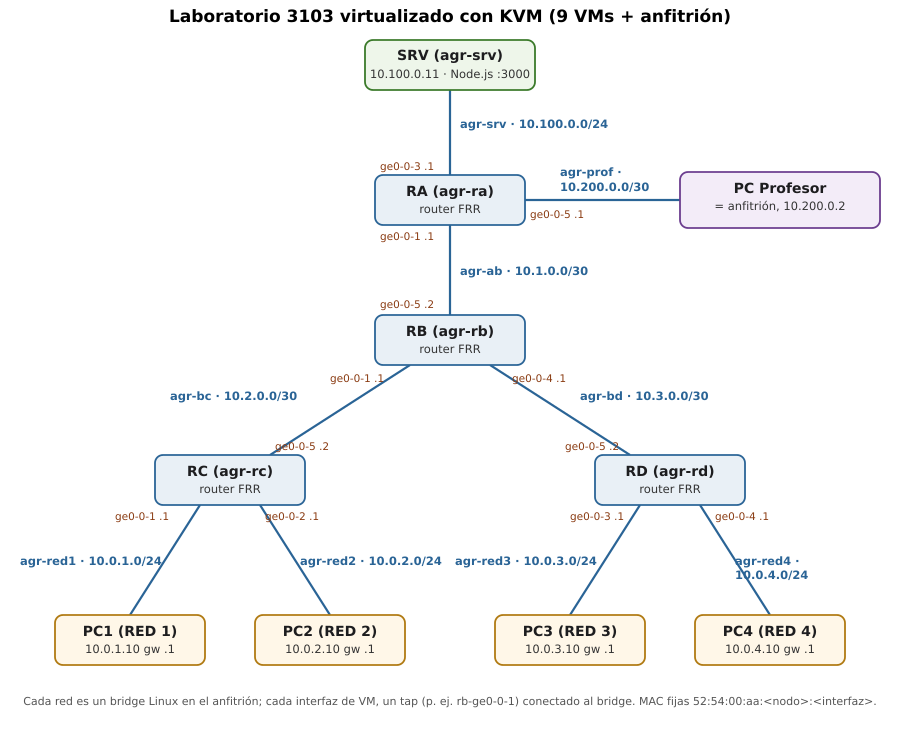

# 1. Objetivo

Desarrollar un script que despliegue con QEMU-KVM una réplica virtual de la
red del laboratorio 3103, instale la *Software Routing Suite* en los routers,
configure las rutas estáticas para lograr conectividad global y despliegue un
servicio web en el servidor, de forma que cualquier máquina de las redes
inferiores y el propio anfitrión accedan a él.

Entregables (carpeta `parte2-kvm/`):

| Fichero | Contenido |
|---|---|
| `agr_kvm.py` | Script principal (Python 3 + `lxml`) |
| `topologia.json` | Plan de numeración: redes, máquinas, interfaces y rutas |
| `plantilla_vm.xml` | XML base de Moodle, del que se generan todos los dominios |
| `guest/` | Ficheros que se instalan dentro de las VMs (red, servicio web, información al iniciar sesión, construcción de la imagen base) |

# 2. Arquitectura de la solución

El script sigue estos pasos (orden `sudo ./agr_kvm.py crear`):

1. **Imagen base común** (`agr-base.qcow2`, se crea una sola vez). Parte de la
   **imagen de disco de Moodle** (Ubuntu 20.04, `root`/`agr`), como recomienda
   el enunciado, sin modificar el original: se copia, se amplía a 6 GB y se
   personaliza con
   `virt-customize` (libguestfs): contraseña de root `agr`, zona horaria, teclado
   español, **FRR** (sucesor de Quagga, la *Software Routing Suite*), agente
   QEMU, herramientas de red, **Node.js** y el servidor **SSR-master-server**
   clonado de GitHub. Los servicios de cada rol quedan deshabilitados.
2. **Bridges en el anfitrión.** Un bridge Linux por cada red del plano
   (`agr-srv`, `agr-prof`, `agr-ab`, `agr-bc`, `agr-bd`, `agr-red1..4`). Se
   desactiva `bridge-nf-call-iptables` para que el cortafuegos del anfitrión
   (ufw/Docker) no filtre el tráfico puenteado.
3. **Anfitrión = PC Profesor.** Se le asigna 10.200.0.2/30 en `agr-prof` y
   rutas hacia todas las redes del laboratorio vía RA (10.200.0.1).
4. **Disco diferencial por máquina** (`qemu-img create -b agr-base.qcow2`): sólo
   almacena los cambios, por lo que 9 VMs ocupan poco más que la imagen base.
5. **Configuración offline de cada disco** con `virt-customize`: hostname,
   `/etc/hosts` con todos los nodos, `/etc/agr/node.conf` (rol, interfaces y
   rutas), `/etc/frr/frr.conf` en los routers (rutas estáticas), activación de
   `frr` o del servicio web según el rol, y la clave SSH pública del usuario.
6. **XML de cada dominio** generado con `lxml.etree` a partir de
   `plantilla_vm.xml` (ver §3.3) y registrado con `virsh define` + `virsh start`.
7. **Espera activa** hasta que el agente QEMU de cada VM responde y el servicio
   de red ha terminado; después se muestra el estado.

Dentro de cada VM, el servicio `agr-net.service` (script `agr-net.sh`) se
ejecuta en el arranque antes que la red y FRR: identifica cada interfaz **por
su MAC** (fijada en el XML), la **renombra como en el plano** (`ge0-0-1`,
`ge0-0-5`, ...; Linux no admite `/` en los nombres), le asigna su IP y activa
el reenvío IP sólo en los routers. Las rutas estáticas de los routers las
instala FRR (`staticd`); las de PCs y servidor (puerta de enlace) las instala
el propio script.

# 3. Plan de numeración



Se respeta el plan de numeración del laboratorio 3103
(`doc/development/enunciado/plan_numeracion_3103.pdf`). Las cuatro redes
inferiores de 8 PC se representan con un PC cada una, como permite el
enunciado, y el PC del profesor es el anfitrión.

## 3.1. Redes (bridges del anfitrión)

| Red | Bridge | Subred | Extremos |
|---|---|---|---|
| Servidores | `agr-srv` | 10.100.0.0/24 | RA ge0-0-3 (.1), SRV (.11) |
| PC Profesor | `agr-prof` | 10.200.0.0/30 | RA ge0-0-5 (.1), anfitrión (.2) |
| RA–RB | `agr-ab` | 10.1.0.0/30 | RA ge0-0-1 (.1), RB ge0-0-5 (.2) |
| RB–RC | `agr-bc` | 10.2.0.0/30 | RB ge0-0-1 (.1), RC ge0-0-5 (.2) |
| RB–RD | `agr-bd` | 10.3.0.0/30 | RB ge0-0-4 (.1), RD ge0-0-5 (.2) |
| RED 1 | `agr-red1` | 10.0.1.0/24 | RC ge0-0-1 (.1), PC1 (.10) |
| RED 2 | `agr-red2` | 10.0.2.0/24 | RC ge0-0-2 (.1), PC2 (.10) |
| RED 3 | `agr-red3` | 10.0.3.0/24 | RD ge0-0-3 (.1), PC3 (.10) |
| RED 4 | `agr-red4` | 10.0.4.0/24 | RD ge0-0-4 (.1), PC4 (.10) |

## 3.2. Máquinas virtuales

| VM (dominio) | Rol | RAM | Interfaz | IP | MAC | Puerta de enlace |
|---|---|---|---|---|---|---|
| RA (`agr-ra`) | router | 384 MB | ge0-0-3 / ge0-0-5 / ge0-0-1 | 10.100.0.1 / 10.200.0.1 / 10.1.0.1 | 52:54:00:aa:01:00..02 | 10.1.0.2 |
| RB (`agr-rb`) | router | 384 MB | ge0-0-5 / ge0-0-1 / ge0-0-4 | 10.1.0.2 / 10.2.0.1 / 10.3.0.1 | 52:54:00:aa:02:00..02 | 10.1.0.1 |
| RC (`agr-rc`) | router | 384 MB | ge0-0-5 / ge0-0-1 / ge0-0-2 | 10.2.0.2 / 10.0.1.1 / 10.0.2.1 | 52:54:00:aa:03:00..02 | 10.2.0.1 |
| RD (`agr-rd`) | router | 384 MB | ge0-0-5 / ge0-0-3 / ge0-0-4 | 10.3.0.2 / 10.0.3.1 / 10.0.4.1 | 52:54:00:aa:04:00..02 | 10.3.0.1 |
| SRV (`agr-srv`) | servidor web | 768 MB | eth0 | 10.100.0.11/24 | 52:54:00:aa:05:00 | 10.100.0.1 |
| PC1 (`agr-pc1`) | PC | 384 MB | eth0 | 10.0.1.10/24 | 52:54:00:aa:06:00 | 10.0.1.1 |
| PC2 (`agr-pc2`) | PC | 384 MB | eth0 | 10.0.2.10/24 | 52:54:00:aa:07:00 | 10.0.2.1 |
| PC3 (`agr-pc3`) | PC | 384 MB | eth0 | 10.0.3.10/24 | 52:54:00:aa:08:00 | 10.0.3.1 |
| PC4 (`agr-pc4`) | PC | 384 MB | eth0 | 10.0.4.10/24 | 52:54:00:aa:09:00 | 10.0.4.1 |
| Anfitrión | PC Profesor | — | agr-prof | 10.200.0.2/30 | — | rutas al lab vía 10.200.0.1 |

## 3.3. Generación de los XML

A partir de `plantilla_vm.xml` (la de Moodle) el script modifica con `lxml`:
`<name>`, `<memory>`/`<currentMemory>`, `<vcpu>`, la ruta del disco, el
emulador (si `/usr/bin/kvm` no existe usa `qemu-system-x86_64`) y el tipo de
dominio (`qemu` si no hay `/dev/kvm`). Sustituye la `<interface>` de la
plantilla por una por conexión, con `<mac>` fija, el bridge de su red y un
nombre de tap legible (`<target dev="rb-ge0-0-1"/>`). Además añade una
`<description>`, un `<channel>` para el agente QEMU y `keymap="es"` en la
consola VNC. Todos los XML generados validan contra el esquema de libvirt
(`virt-xml-validate`). Se pueden obtener sin desplegar nada con
`./agr_kvm.py xml --salida <dir>`.

# 4. Tablas de enrutamiento

Las rutas estáticas se configuran en FRR (`/etc/frr/frr.conf`, demonio
`staticd`), tal como figuran en el plano. Ejemplo de RB:

```
frr defaults traditional
hostname RB
ip forwarding
interface ge0-0-5
 description Enlace RA - RB 10.1.0.0/30
...
ip route 10.0.1.0/24 10.2.0.2
ip route 10.0.2.0/24 10.2.0.2
ip route 10.0.3.0/24 10.3.0.2
ip route 10.0.4.0/24 10.3.0.2
ip route 0.0.0.0/0 10.1.0.1
```

| Router | Destino | Next-hop | Interfaz de salida |
|---|---|---|---|
| **RA** | 10.100.0.0/24 | directamente conectada | ge0-0-3 |
| | 10.200.0.0/30 | directamente conectada | ge0-0-5 |
| | 10.1.0.0/30 | directamente conectada | ge0-0-1 |
| | 0.0.0.0/0 | 10.1.0.2 (RB) | ge0-0-1 |
| **RB** | 10.0.1.0/24, 10.0.2.0/24 | 10.2.0.2 (RC) | ge0-0-1 |
| | 10.0.3.0/24, 10.0.4.0/24 | 10.3.0.2 (RD) | ge0-0-4 |
| | 10.1.0.0/30, 10.2.0.0/30, 10.3.0.0/30 | directamente conectadas | ge0-0-5, ge0-0-1, ge0-0-4 |
| | 0.0.0.0/0 | 10.1.0.1 (RA) | ge0-0-5 |
| **RC** | 10.2.0.0/30, 10.0.1.0/24, 10.0.2.0/24 | directamente conectadas | ge0-0-5, ge0-0-1, ge0-0-2 |
| | 0.0.0.0/0 | 10.2.0.1 (RB) | ge0-0-5 |
| **RD** | 10.3.0.0/30, 10.0.3.0/24, 10.0.4.0/24 | directamente conectadas | ge0-0-5, ge0-0-3, ge0-0-4 |
| | 0.0.0.0/0 | 10.3.0.1 (RB) | ge0-0-5 |

**Observaciones sobre el plan.**

- En la tabla de RA del plano falta la red 10.1.0.0/30, que también está
  directamente conectada (es la que permite alcanzar el next-hop 10.1.0.2).
- RA tiene ruta por defecto hacia RB y RB hacia RA. Un paquete a un destino
  que no existe en el laboratorio (p. ej. 8.8.8.8) rebota entre ambos hasta
  agotar el TTL. En el laboratorio real RA tendría la salida a Internet; en la
  réplica no la hay, lo que no afecta a la conectividad interna.
- RA no necesita rutas específicas a las redes inferiores porque su ruta por
  defecto ya apunta hacia RB, que sí las conoce.

# 5. Plan de pruebas

**Requisitos que se verifican** (enunciado, pág. 4):

> «configurar las rutas estáticas correspondientes para **lograr conectividad
> global**» · «que cualquiera de las máquinas situadas en la parte inferior de
> la red tenga acceso al servicio web del servidor. La máquina anfitriona
> también deberá tener acceso al servidor» · «indicar el plan de pruebas que ha
> llevado a cabo para **confirmar que existe conectividad global**».

La conectividad entre PCs de redes inferiores distintas es, por tanto, un
resultado esperado: además del enunciado, la deducen las propias tablas del
plano (RB tiene rutas a 10.0.1–4.0/24 y RC/RD tienen su ruta por defecto hacia
RB), de modo que PC1 → PC3 sigue RC → RB → RD sin configuración adicional.

La orden `sudo ./agr_kvm.py probar --informe <fichero>` ejecuta
automáticamente el plan de pruebas. Las órdenes dentro de las VMs se lanzan a
través del **agente QEMU** (`virsh qemu-agent-command ... guest-exec`), sin
necesidad de red de gestión ni SSH:

1. **Anfitrión (PC Profesor) → todas las interfaces** de los 9 nodos (`ping`),
   y `HTTP GET` al servidor web (`http://10.100.0.11:3000/`).
2. **Cada PC de las redes inferiores → servidor**: `ping`, `HTTP GET /`,
   `HTTP GET /record?...` (escritura de datos en el servidor) y `traceroute`
   para verificar el camino (PCx → RC/RD → RB → RA → SRV).
3. **Conectividad entre redes inferiores**: ping de cada PC a los otros tres.
4. **Tablas de rutas** de los routers (`vtysh -c 'show ip route'`).

## 5.1. Resultados

El plan se ejecutó sobre el despliegue completo (9 VMs). Resultado:
**50/50 pruebas correctas**. El informe completo, con las tablas de rutas y
los `traceroute`, está en `doc/development/parte2/pruebas.txt`.

| Bloque | Pruebas | Correctas |
|---|---|---|
| Anfitrión → 17 interfaces + servidor web | 18 | 18 |
| PCs → servidor (ping, HTTP, escritura, traceroute) | 16 | 16 |
| Conectividad entre las 4 redes inferiores | 12 | 12 |
| Tablas de rutas de RA–RD | 4 | 4 |

Los `traceroute` confirman que los caminos son los del plano:

| Origen | Saltos hasta 10.100.0.11 |
|---|---|
| PC1 (RED 1) | 10.0.1.1 (RC) → 10.2.0.1 (RB) → 10.1.0.1 (RA) → 10.100.0.11 |
| PC2 (RED 2) | 10.0.2.1 (RC) → 10.2.0.1 (RB) → 10.1.0.1 (RA) → 10.100.0.11 |
| PC3 (RED 3) | 10.0.3.1 (RD) → 10.3.0.1 (RB) → 10.1.0.1 (RA) → 10.100.0.11 |
| PC4 (RED 4) | 10.0.4.1 (RD) → 10.3.0.1 (RB) → 10.1.0.1 (RA) → 10.100.0.11 |

Tabla de rutas de RB obtenida con `vtysh -c 'show ip route'` (S = estática,
C = conectada):

```
S>* 0.0.0.0/0 [1/0] via 10.1.0.1, ge0-0-5
S>* 10.0.1.0/24 [1/0] via 10.2.0.2, ge0-0-1
S>* 10.0.2.0/24 [1/0] via 10.2.0.2, ge0-0-1
S>* 10.0.3.0/24 [1/0] via 10.3.0.2, ge0-0-4
S>* 10.0.4.0/24 [1/0] via 10.3.0.2, ge0-0-4
C>* 10.1.0.0/30 is directly connected, ge0-0-5
C>* 10.2.0.0/30 is directly connected, ge0-0-1
C>* 10.3.0.0/30 is directly connected, ge0-0-4
```

## 5.2. Incidencias detectadas y corregidas

- **Rutas perdidas en los routers bajo carga.** Con todas las VMs arrancando a
  la vez, `watchfrr` (el supervisor de FRR) consideró caído a `staticd` por
  tardar más de 10 s en responder y lo reinició. Un demonio reiniciado por
  separado no recibe la configuración, por lo que RC quedó sin ruta por
  defecto (PC1 y PC2 sin conectividad). Solución: plazos de `watchfrr` más
  amplios (`-t 60 -T 90`) y reaplicación de la configuración (`vtysh -b`) tras
  arrancar FRR. Comprobado reiniciando los 4 routers simultáneamente.
- **Espera insuficiente.** La orden `probar` esperaba sólo al servicio de red;
  ahora espera además a que cada nodo tenga todas sus rutas instaladas.

# 6. Consumo de recursos

Medidas sobre el despliegue completo (9 VMs) en el anfitrión de prácticas
(AMD Ryzen 7 7700X, 30 GiB de RAM, Ubuntu 24.04, KVM). Datos en bruto en
`doc/development/parte2/consumo_kvm_raw.txt`.

## 6.1. Memoria

RAM real de cada proceso QEMU en el anfitrión (RSS):

| VM | RAM asignada | RSS en el anfitrión | RAM usada dentro de la VM |
|---|---|---|---|
| RA | 384 MB | 406 MiB | ~120 MB |
| RB | 384 MB | 408 MiB | ~120 MB |
| RC | 384 MB | 406 MiB | ~120 MB |
| RD | 384 MB | 405 MiB | ~120 MB |
| SRV | 768 MB | 456 MiB | ~220 MB |
| PC1 | 384 MB | 390 MiB | ~90 MB |
| PC2 | 384 MB | 392 MiB | ~90 MB |
| PC3 | 384 MB | 390 MiB | ~90 MB |
| PC4 | 384 MB | 397 MiB | ~90 MB |
| **Total** | **3840 MB** | **3651 MiB (3.6 GiB)** | ~1.1 GB |

- Cada VM de 384 MB cuesta al anfitrión **~400 MiB**: toda su RAM (el
  invitado usa la libre como caché de disco) más **~20 MiB de sobrecarga** de
  QEMU, bastante menos que los ~70 MiB de VirtualBox en la parte 1.
- El servidor, con 768 MB asignados, sólo ocupa **456 MiB**: KVM únicamente
  reserva las páginas que el invitado llega a tocar, y el servidor nunca ha
  necesitado toda su RAM.
- El laboratorio completo (9 VMs) ocupa **3.6 GiB**, el **12 %** de la RAM
  del anfitrión, lo que confirma la estimación de la parte 1 (≈ 3.1 GiB con
  256/512 MB por VM). Con el uso real de los invitados (~1.1 GB) se podrían
  reducir las asignaciones casi a la mitad.

## 6.2. Disco

| Recurso | Medida |
|---|---|
| Imagen base (`agr-base.qcow2`, 6 GB virtuales) | **1.26 GB** |
| Disco diferencial de cada router | 22–23 MB |
| Disco diferencial de cada PC y del servidor | 14–15 MB |
| **Disco total de las 9 VMs** | **≈ 1.43 GB** |

Gracias a los discos diferenciales, las 9 VMs ocupan **menos que la única VM
de la parte 1** (2.1 GB de disco diferencial + 811 MB de *box*).

## 6.3. Extrapolación

| Escenario | VMs | RAM (≈ 400 MiB por VM) | Disco |
|---|---|---|---|
| Réplica reducida (desplegada) | 9 | 3.6 GiB | 1.4 GB |
| Réplica completa (32 PC + 2 servidores) | 38 | ~15 GiB | ~2 GB |
| Servidor comercial de 1 TB de RAM | ~2300 VMs | ≈ 60 réplicas completas | — |

Frente a la parte 1 (≈ 1.07 GiB por VM de 1 GB con VirtualBox), la combinación
KVM + discos diferenciales + asignación ajustada multiplica por ~2.7 el número
de VMs por GB de RAM y por ~18 el de VMs por GB de disco (0.34 VMs/GB en la parte 1 frente a 6.3 VMs/GB aquí).

# 7. Configuraciones adicionales

- **Interfaces con el nombre del plano** (`ge0-0-x`) e identificación por MAC,
  independiente del orden de detección PCI.
- **FRR** como *Software Routing Suite*, con descripción de cada interfaz y
  `ip forwarding`; administrable con `vtysh`.
- **Discos diferenciales qcow2** sobre una imagen base común (ahorro de disco
  y despliegue rápido) y **imagen base reutilizable** entre ejecuciones.
- **Servicio web** como unidad systemd con usuario sin privilegios y reinicio
  automático.
- **Información al iniciar sesión** en cada VM (rol, interfaces, rutas, estado
  de FRR o del servidor web).
- **Agente QEMU** para automatizar las pruebas desde el anfitrión.
- **Clave SSH** del usuario inyectada en todas las VMs: `ssh root@10.100.0.11`.
- **Teclado español** en consola y VNC, zona horaria `Europe/Madrid`.
- **Trazas** con el módulo `logging` (opción `-v`) y validación de la
  topología (cada IP pertenece a su red) antes de desplegar.
- **Consolas**: `./agr_kvm.py consola rc` abre un `xterm` en segundo plano con
  `virsh console`.

# 8. Uso del script

```
cd parte2-kvm
sudo ./agr_kvm.py instalar              # dependencias del anfitrión (una vez)
sudo ./agr_kvm.py crear                 # despliega todo (la 1ª vez crea la imagen base)
sudo ./agr_kvm.py estado
sudo ./agr_kvm.py probar --informe pruebas.txt
sudo ./agr_kvm.py consola ra rb         # consolas (root / agr)
sudo ./agr_kvm.py consumo               # RAM, CPU y disco de cada VM
sudo ./agr_kvm.py parar                 # apagar;  'arrancar' para volver a encender
sudo ./agr_kvm.py destruir [--todo]     # borrar (con --todo también la imagen base)
```

La imagen de Moodle se coloca en `parte2-kvm/imagen/agr-vm-base.qcow2` (o se
descarga del Release `imagen-moodle`). El script carga KVM y descarga
VirtualBox antes de arrancar, y libera KVM al `parar`/`destruir`.
