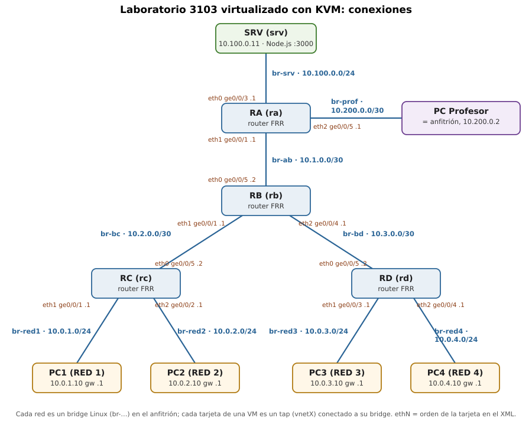

# 1. Diagrama de red



Cada **red** del plano es un **bridge Linux** (`br-…`) en el anfitrión, que
hace de switch. Cada **tarjeta** de una máquina virtual es un tap (`vnetX`)
que libvirt conecta a su bridge al arrancar la máquina. Dentro de las VMs las
tarjetas se llaman `eth0`, `eth1`, `eth2` en el orden en que aparecen en su
XML (la imagen arranca con `net.ifnames=0`).

Esquema simplificado:

```
              [SRV] 10.100.0.11
                |  br-srv 10.100.0.0/24
              [RA] --- br-prof 10.200.0.0/30 --- [Anfitrión] 10.200.0.2
                |  br-ab 10.1.0.0/30
              [RB]
   br-bc       /    \       br-bd
 10.2.0.0/30  /      \  10.3.0.0/30
           [RC]      [RD]
           /  \      /  \
   br-red1  br-red2  br-red3  br-red4
      |        |        |        |
    [PC1]    [PC2]    [PC3]    [PC4]
  10.0.1.10 10.0.2.10 10.0.3.10 10.0.4.10
```

# 2. Esquema de conexiones

## 2.1. Redes (bridges del anfitrión)

| Bridge | Red del plano | Subred | Equipos conectados |
|---|---|---|---|
| `br-srv` | Red de servidores | 10.100.0.0/24 | SRV (eth0), RA (eth0) |
| `br-prof` | Enlace del PC Profesor | 10.200.0.0/30 | RA (eth2), anfitrión |
| `br-ab` | Enlace RA–RB | 10.1.0.0/30 | RA (eth1), RB (eth0) |
| `br-bc` | Enlace RB–RC | 10.2.0.0/30 | RB (eth1), RC (eth0) |
| `br-bd` | Enlace RB–RD | 10.3.0.0/30 | RB (eth2), RD (eth0) |
| `br-red1` | RED 1 (SW1) | 10.0.1.0/24 | RC (eth1), PC1 (eth0) |
| `br-red2` | RED 2 (SW2) | 10.0.2.0/24 | RC (eth2), PC2 (eth0) |
| `br-red3` | RED 3 (SW3) | 10.0.3.0/24 | RD (eth1), PC3 (eth0) |
| `br-red4` | RED 4 (SW4) | 10.0.4.0/24 | RD (eth2), PC4 (eth0) |

Los nueve bridges los crea `parte2/red.sh`, que también da al anfitrión su IP
de PC Profesor y sus rutas hacia el laboratorio.

## 2.2. Tarjetas de cada equipo

| Equipo | Tarjeta | Puerto del plano | Bridge | IP | Puerta de enlace |
|---|---|---|---|---|---|
| **RA** | eth0 | ge0/0/3 | br-srv | 10.100.0.1/24 | — (router) |
| | eth1 | ge0/0/1 | br-ab | 10.1.0.1/30 | |
| | eth2 | ge0/0/5 | br-prof | 10.200.0.1/30 | |
| **RB** | eth0 | ge0/0/5 | br-ab | 10.1.0.2/30 | — (router) |
| | eth1 | ge0/0/1 | br-bc | 10.2.0.1/30 | |
| | eth2 | ge0/0/4 | br-bd | 10.3.0.1/30 | |
| **RC** | eth0 | ge0/0/5 | br-bc | 10.2.0.2/30 | — (router) |
| | eth1 | ge0/0/1 | br-red1 | 10.0.1.1/24 | |
| | eth2 | ge0/0/2 | br-red2 | 10.0.2.1/24 | |
| **RD** | eth0 | ge0/0/5 | br-bd | 10.3.0.2/30 | — (router) |
| | eth1 | ge0/0/3 | br-red3 | 10.0.3.1/24 | |
| | eth2 | ge0/0/4 | br-red4 | 10.0.4.1/24 | |
| **SRV** | eth0 | — | br-srv | 10.100.0.11/24 | 10.100.0.1 (RA) |
| **PC1** | eth0 | — | br-red1 | 10.0.1.10/24 | 10.0.1.1 (RC) |
| **PC2** | eth0 | — | br-red2 | 10.0.2.10/24 | 10.0.2.1 (RC) |
| **PC3** | eth0 | — | br-red3 | 10.0.3.10/24 | 10.0.3.1 (RD) |
| **PC4** | eth0 | — | br-red4 | 10.0.4.10/24 | 10.0.4.1 (RD) |
| **Anfitrión** | br-prof | — | br-prof | 10.200.0.2/30 | rutas a las 8 redes del laboratorio vía 10.200.0.1 (RA) |

Las IPs de las VMs están en `/etc/network/interfaces` de cada una. En los
routers además está activo el reenvío IP (`/etc/sysctl.d/99-router.conf`).

## 2.3. Tablas de enrutamiento (FRR, `show ip route`)

Configuradas con `vtysh` y guardadas con `write memory` en `/etc/frr/frr.conf`.
`S` = estática, `C` = directamente conectada.

**RA**

```
S>* 0.0.0.0/0 [1/0] via 10.1.0.2, eth1
C>* 10.1.0.0/30 is directly connected, eth1
C>* 10.100.0.0/24 is directly connected, eth0
C>* 10.200.0.0/30 is directly connected, eth2
```

**RB**

```
S>* 0.0.0.0/0 [1/0] via 10.1.0.1, eth0
S>* 10.0.1.0/24 [1/0] via 10.2.0.2, eth1
S>* 10.0.2.0/24 [1/0] via 10.2.0.2, eth1
S>* 10.0.3.0/24 [1/0] via 10.3.0.2, eth2
S>* 10.0.4.0/24 [1/0] via 10.3.0.2, eth2
C>* 10.1.0.0/30 is directly connected, eth0
C>* 10.2.0.0/30 is directly connected, eth1
C>* 10.3.0.0/30 is directly connected, eth2
```

**RC**

```
S>* 0.0.0.0/0 [1/0] via 10.2.0.1, eth0
C>* 10.0.1.0/24 is directly connected, eth1
C>* 10.0.2.0/24 is directly connected, eth2
C>* 10.2.0.0/30 is directly connected, eth0
```

**RD**

```
S>* 0.0.0.0/0 [1/0] via 10.3.0.1, eth0
C>* 10.0.3.0/24 is directly connected, eth1
C>* 10.0.4.0/24 is directly connected, eth2
C>* 10.3.0.0/30 is directly connected, eth0
```

Coinciden con las tablas del plano. RA también tiene directamente conectada
la red 10.1.0.0/30, que la tabla del plano no lista.

> Pendiente de confirmar: las salidas de RB y RC son capturas reales. Las de RA
> (ya con `eth2`) y RD son las esperadas según la configuración aplicada y hay
> que sustituirlas por la captura de `vtysh -c 'show ip route'` en cada uno.

# 3. Tabla de accesos

## 3.1. Quién llega a quién (resultado de las pruebas)

Desde cada equipo (filas) se hizo ping a todas las IPs de cada destino
(columnas) y una petición HTTP al servidor web.

| Origen ↓ / Destino → | SRV | RA | RB | RC | RD | PC1 | PC2 | PC3 | PC4 | Prof. | Web (HTTP) |
|---|---|---|---|---|---|---|---|---|---|---|---|
| **SRV** | — | ✅ | ✅ | ✅ | ✅ | ✅ | ✅ | ✅ | ✅ | ✅ | 200 |
| **RA** | ✅ | — | ✅ | ✅ | ✅ | ✅ | ✅ | ✅ | ✅ | ✅ | 200 |
| **RB** | ✅ | ✅ | — | ✅ | ✅ | ✅ | ✅ | ✅ | ✅ | ✅ | 200 |
| **RC** | ✅ | ✅ | ✅ | — | ✅ | ✅ | ✅ | ✅ | ✅ | ✅ | 200 |
| **RD** | ✅ | ✅ | ✅ | ✅ | — | ✅ | ✅ | ✅ | ✅ | ✅ | 200 |
| **PC1** | ✅ | ✅ | ✅ | ✅ | ✅ | — | ✅ | ✅ | ✅ | ✅ | 200 |
| **PC2** | ✅ | ✅ | ✅ | ✅ | ✅ | ✅ | — | ✅ | ✅ | ✅ | 200 |
| **PC3** | ✅ | ✅ | ✅ | ✅ | ✅ | ✅ | ✅ | — | ✅ | ✅ | 200 |
| **PC4** | ✅ | ✅ | ✅ | ✅ | ✅ | ✅ | ✅ | ✅ | — | ✅ | 200 |
| **Prof.** | ✅ | ✅ | ✅ | ✅ | ✅ | ✅ | ✅ | ✅ | ✅ | — | 200 |

**Conectividad global: 10 equipos × 18 IPs = 180/180 pings correctos y
10/10 accesos web.**

## 3.2. Routers que atraviesa el tráfico entre equipos finales

| Entre | Camino | Routers |
|---|---|---|
| PC1 ↔ PC2 | RC | 1 |
| PC3 ↔ PC4 | RD | 1 |
| SRV ↔ PC Profesor | RA | 1 |
| PC1/PC2 ↔ PC3/PC4 | RC → RB → RD | 3 |
| PC1/PC2 ↔ SRV | RC → RB → RA | 3 |
| PC3/PC4 ↔ SRV | RD → RB → RA | 3 |
| PC1/PC2 ↔ PC Profesor | RC → RB → RA | 3 |
| PC3/PC4 ↔ PC Profesor | RD → RB → RA | 3 |

El número de routers se confirma con el TTL de las respuestas: 64 (misma
red), 63 (1 router), 61 (3 routers).

# 4. Plan de pruebas

## 4.1. Pruebas paso a paso durante la construcción

| Paso | Prueba | Resultado |
|---|---|---|
| Red de servidores | RA ↔ SRV (ping) | ✅ |
| Enlace RA–RB | RB → RA; RB → SRV antes de configurar rutas | ✅ / ❌ *Network is unreachable* (esperado) |
| Rutas en RA y RB | RB → SRV (ping, traceroute `10.1.0.1` → `10.100.0.11`) | ✅ |
| Rama de RC | RC → SRV (traceroute `10.2.0.1` → `10.1.0.1` → `10.100.0.11`) | ✅ tras corregir la incidencia de §5 |
| PC1 y PC2 | PC2 → RC, PC1, SRV (traceroute de 4 saltos) | ✅ |
| Rama de RD | PC3 → RD, SRV; PC4 → RD, PC3, PC1, SRV | ✅ |
| PC Profesor | anfitrión → RA, SRV, PC1; traceroute a PC4 | ✅ |
| Servidor web | `curl` y `/record` desde PC1, PC4 y el anfitrión; CSV creados en SRV | ✅ |

## 4.2. Prueba final de conectividad global

Orden ejecutada en cada uno de los 10 equipos (9 VMs y el anfitrión):

```bash
H=$(hostname); ok=0; fail=""
for ip in 10.100.0.11 10.100.0.1 10.200.0.1 10.200.0.2 10.1.0.1 10.1.0.2 \
          10.2.0.1 10.2.0.2 10.3.0.1 10.3.0.2 10.0.1.1 10.0.1.10 10.0.2.1 \
          10.0.2.10 10.0.3.1 10.0.3.10 10.0.4.1 10.0.4.10; do
  if ping -c1 -W1 $ip >/dev/null 2>&1; then ok=$((ok+1)); else fail="$fail $ip"; fi
done
web=$(curl -s -o /dev/null -w '%{http_code}' --max-time 5 http://10.100.0.11:3000/)
echo "$H: $ok/18 OK, web=$web, fallan:${fail:- ninguna}"
```

Resultado en los 10 equipos: `18/18 OK, web=200, fallan: ninguna`.

## 4.3. Caminos comprobados con `traceroute`

```
PC2 → SRV:  10.0.2.1 (RC) → 10.2.0.1 (RB) → 10.1.0.1 (RA) → 10.100.0.11
PC3 → SRV:  10.0.3.1 (RD) → 10.3.0.1 (RB) → 10.1.0.1 (RA) → 10.100.0.11
PC4 → SRV:  10.0.4.1 (RD) → 10.3.0.1 (RB) → 10.1.0.1 (RA) → 10.100.0.11
RC  → SRV:  10.2.0.1 (RB) → 10.1.0.1 (RA) → 10.100.0.11
RB  → SRV:  10.1.0.1 (RA) → 10.100.0.11
```

## 4.4. Servicio web

| Origen | Petición | Resultado |
|---|---|---|
| PC1 | `GET /` y `/record?id_nodo=pc1…` | HTML de Data-Logger; `pc1-2026-9-25.csv` creado en SRV |
| PC4 | `GET /` y `/record?id_nodo=pc4…` | HTML; `pc4-2026-9-25.csv` |
| Anfitrión | `GET /` y `/record?id_nodo=profesor…` | HTML; `profesor-2026-9-25.csv` |

El servidor escucha en `*:3000` (todas las IPs de SRV). El mes del nombre del
CSV aparece como 9 en octubre porque el servidor usa `getMonth()` de
JavaScript, que numera los meses desde 0.

# 5. Incidencias encontradas

| Incidencia | Causa | Solución |
|---|---|---|
| RC → SRV: *Destination Net Unreachable* desde RB | `systemctl restart networking` en RB borró del kernel la ruta por defecto que había instalado FRR, y FRR no la reinstaló | `systemctl restart frr` tras reiniciar la red en un router |
| PC3 → RD: *Destination Host Unreachable* | RD aún no existía: nadie respondía al ARP de la puerta de enlace | Crear y configurar RD |
| `virsh start`: *Cannot get interface MTU on 'br-…'* | Los bridges no sobreviven al reinicio del anfitrión | `parte2/red.sh` los recrea |
| `virsh define`: *domain already exists with uuid* | El XML no lleva UUID y la máquina ya estaba definida | `shutdown` → `undefine` → `define` → `start` |
| `virsh list` sin `sudo` vacío | Sin `sudo` se usa `qemu:///session` en vez de `qemu:///system` | Usar `sudo virsh` |
